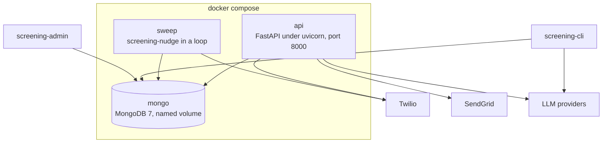
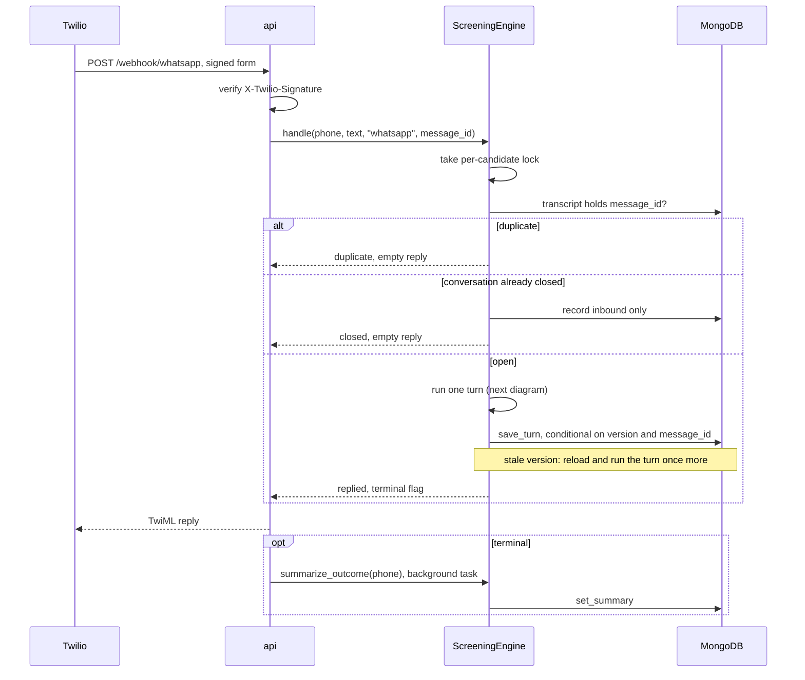
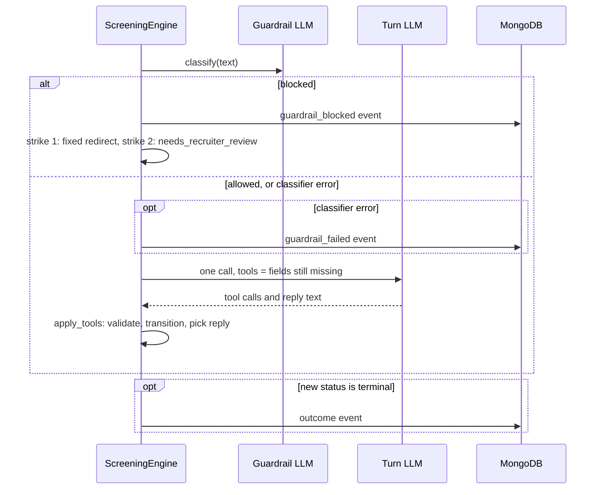
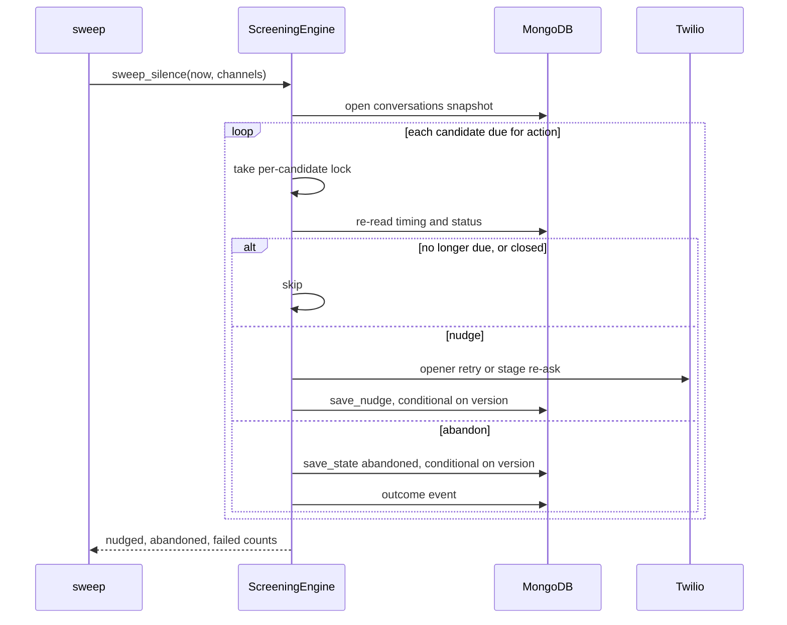

# Grupo Sazón screening agent

AI candidate-screening agent for delivery-driver hiring, plus a recruiter API and recruiter pages. Take-home for Orbio.

Documents:

- `docs/process-design.md`: the Phase 1 process design (stages, validation, outcomes, tone).
- `docs/STATUS.md`: project status, known gaps, open questions and remaining work.
- `docs/Orbio-Assignment.md`: the brief.

## Setup

```bash
python3.12 -m venv .venv
source .venv/bin/activate
pip install -e ".[dev]"            # add ,evals for the OpenAI and Mistral bake-off candidates
export PROJECT_ANTHROPIC_API_KEY=... # Anthropic models; not ANTHROPIC_API_KEY, which Claude Code reads
export SCREENING_DEV_MODE=true      # local only: lets the API run without the secrets below
export SCREENING_SESSION_SECRET=...        # signs the recruiter session cookie, see below
export SCREENING_RECRUITER_EMAIL_DOMAINS='["gruposazon.com"]'   # who may log in
export SCREENING_SENDGRID_API_KEY=SG...    # login links go out through Twilio SendGrid
export SCREENING_LOGIN_EMAIL_FROM=...      # a sender verified in SendGrid
export SCREENING_PUBLIC_URL=https://...    # base URL of every login link; required outside dev mode
export SCREENING_TWILIO_AUTH_TOKEN=...     # verifies X-Twilio-Signature on the webhook
export SCREENING_TWILIO_WEBHOOK_URL=...    # the exact URL set in the Twilio console, see below
export SCREENING_TWILIO_ACCOUNT_SID=...    # outbound: opener and nudges, used in the Messages URL
export SCREENING_TWILIO_API_KEY_SID=SK...  # outbound REST auth (API key, not the auth token)
export SCREENING_TWILIO_API_KEY_SECRET=...
export SCREENING_TWILIO_WHATSAPP_FROM=+14155238886
export SCREENING_TWILIO_OPENER_CONTENT_SID=HX...   # approved opener template; plain text fallback in sandbox
export SCREENING_DATABASE_URL=mongodb://localhost:27017/screening
```

Docker: copy `.env.example` to `.env`, fill the secrets, then `docker compose up --build`. The stack runs the API on port 8000, a sweep loop and MongoDB with a named volume. Tests also need Docker: pytest starts a throwaway `mongo:7` container and skips the repository-backed tests when no Docker socket is present.

Configuration is read from `SCREENING_*` environment variables or `.env`. See `screening_agent/config.py` for every setting and its default.

### Recruiter login

Recruiters do not get a password or a key. They type their work email at `/recruiter/login` and click the link that arrives. Any address at a domain in `SCREENING_RECRUITER_EMAIL_DOMAINS` enrolls itself on first login. The recruiter row is created when the link is used. The link works once and expires after `SCREENING_LOGIN_LINK_MINUTES` (default 15). It always points at `SCREENING_PUBLIC_URL`, never at the request's `Host` header, which a caller can forge. Only dev mode falls back to the request URL. Each address gets one email per `SCREENING_LOGIN_EMAIL_COOLDOWN_SECONDS` (60) and each client IP at most `SCREENING_LOGIN_REQUESTS_PER_IP` (30) per `SCREENING_LOGIN_IP_WINDOW_MINUTES` (60). Behind a proxy, set uvicorn's `FORWARDED_ALLOW_IPS` so the limit sees the caller and not the proxy. A throttled request and a mail-provider failure both answer "check your inbox". The session cookie lasts `SCREENING_SESSION_HOURS` (default 12) and is signed with `SCREENING_SESSION_SECRET`, which is the one secret this app owns. Generate it once:

```bash
python -c "import secrets; print(secrets.token_urlsafe(32))"
```

Without SendGrid credentials in dev mode, the login link is printed to the server log.

### Machine clients and admin

Machine clients send a per-client key in the `X-API-Key` header. Mint, list and revoke keys and manage recruiters with the admin CLI:

```bash
screening-admin create-api-key ats-sync   # prints the key once
screening-admin api-keys
screening-admin revoke-api-key <key id>
screening-admin recruiters
screening-admin deactivate ana@gruposazon.com
```

Every override event records who did it (`recruiter:<email>` or `api_key:<label>`).

### Twilio webhook

`SCREENING_TWILIO_WEBHOOK_URL` is the public URL you type into the Twilio console as the WhatsApp sender's "when a message comes in" webhook, for example `https://<your-tunnel-host>/webhook/whatsapp`. Twilio signs that exact string. Set it when the app sees a different URL than Twilio called, which is the case behind a tunnel or reverse proxy, including the Docker stack behind ngrok. Leave it empty when Twilio reaches the app directly at the URL it signed.

## Run

```bash
screening-cli                        # text chat against the screening flow
uvicorn screening_agent.api.app:app  # webhook, candidates, analytics, recruiter pages at /recruiter/
screening-nudge                      # silence sweep for cron: nudges, then abandons
pytest                               # unit and flow tests, no LLM calls
python -m evals.run_evals            # persona evals against the configured models, PASS/FAIL per persona
python -m evals.run_evals --models anthropic:claude-sonnet-5-5,openai:gpt-6.1-sol,mistralai:mistral-medium-latest \
    --guardrail-models anthropic:claude-haiku-5-5,openai:gpt-6-luna --judge --report docs/bakeoff.md
ruff check . && ruff format .
```

## HTTP surface

| Route | Auth | Purpose |
| --- | --- | --- |
| `POST /webhook/whatsapp` | Twilio signature | Inbound candidate message. Answers TwiML with the reply. |
| `POST /candidates` | recruiter | Opens a conversation and sends the opener. Candidate id is the E.164 phone. |
| `GET /candidates` | recruiter | Candidate list. |
| `GET /candidates/{id}` | recruiter | Profile, summary, transcript and events. |
| `PATCH /candidates/{id}` | recruiter | Outcome override. Writes a `recruiter_override` event with the actor. |
| `GET /analytics` | recruiter | Funnel counts. |
| `/recruiter/...` | session cookie | Server-rendered pages: login, candidate table with filters and funnel, detail with override form. |

"recruiter" means a session cookie or an `X-API-Key`. Routes answer 503 until their secrets are configured, unless `SCREENING_DEV_MODE` is on. Page routes answer 303 to login instead of 401.

## How it works, in plain language

This section is for reviewers and readers who do not write code. It describes what the system does and who decides what. The Architecture section after it gives the same system in technical diagrams.

### What the system does

A candidate applies for a delivery-driver job. A recruiter, or the company's hiring software, registers the candidate's phone number with the system. The candidate then gets a WhatsApp message from an assistant called Sazón. This first message is called the opener. The link from the application form to this system is not built, so today the registration is a manual or external step. The assistant says it is an AI, asks for permission to continue, then asks seven short questions one at a time. The conversation ends in one of four results. A recruiter sees the result, a short summary, the full chat and every decision the system made.

The goal is simple. Recruiters today spend most of their phone time on people who cannot be hired. The assistant does the first pass and hands recruiters only the candidates who passed the two objective checks: a valid driving licence and a home city where Grupo Sazón has a restaurant.

### Two parts: the AI that talks and the code that decides

The system has two parts with different jobs.

- **The AI model talks.** It reads the candidate's message, understands it in Spanish or English, and writes a friendly one-line reply. It also fills in the boxes of a form that the message answers, usually one, for example "has licence: yes". A second, smaller AI check runs before it and only decides whether the message is about the application.
- **The code decides.** The code owns the form, the order of the questions, the rules for a valid answer, the four results and every message that matters legally.

A useful picture is an interviewer with a clipboard. The AI is the interviewer. The code is the clipboard. The clipboard shows only the question that comes next. The interviewer cannot write in a box that is not on the page. So the AI cannot ask about experience before the licence question, because that box does not exist yet. The code adds it only after the licence answer is recorded.

This is the single most important design choice. The rules about consent, question order and rejection do not depend on the AI following instructions. They depend on which boxes the code shows it.

### The questions, in order

The questions run cheapest disqualifier first. The two hard stops come before any detail a recruiter would read.

| Step | Question | What can happen |
| --- | --- | --- |
| 1 | May we continue? (consent) | No: the chat stops and a recruiter follows up. |
| 2 | Full name | Unclear: asked again once, with an example. |
| 3 | Valid driving licence? | No: not qualified. The candidate hears the real reason. |
| 4 | Which city? | No restaurant there: not qualified. Close match: the assistant asks "Do you mean X?" first. |
| 5 | Availability (full-time, part-time, weekends) | Unclear: asked again once. |
| 6 | Preferred shift | Unclear: asked again once. |
| 7 | Delivery experience | Zero is a valid answer. |
| 8 | Start date | A past date: asked again once. |

A candidate who answers several questions in one message skips ahead. The code accepts every answer it can match and moves to the first question still open.

### The four results

| Result | Who decides | What the candidate hears |
| --- | --- | --- |
| Qualified | Code, when every answer is valid | A recruiter will book a short interview. |
| Not qualified | Code, only for no licence or no restaurant nearby | The real reason, and that the application stays on file. |
| Needs a recruiter | Code, when the candidate says no to consent or anything is unclear | A recruiter will follow up. |
| Abandoned | Code, after a long silence | Nothing further. |

Only two facts cause an automatic no. Everything that needs judgement goes to a person. A recruiter can change any result from the recruiter web page, and the change is logged with their name.

### What happens to one message

1. The candidate sends a WhatsApp message. Twilio, the messaging provider, forwards it to the system.
2. The system checks the message really came from Twilio. A forged message is rejected. This check is active in the production configuration; the local development mode can run without it.
3. The system checks it has not already handled this exact message. Twilio delivers a message again when it gets no answer. A repeat is ignored.
4. A small, fast AI check asks: is this message about the application? Off-topic or abusive messages get one polite redirect. A second one closes the chat for a recruiter to review. If this check itself fails for a technical reason, the message goes through instead of being blocked.
5. The main AI model reads the message with the open questions in front of it. It fills in the matching box and writes a reply.
6. The code checks the answer against the rules. A valid answer is recorded and the next question is prepared. An invalid answer is asked again with a fixed example message. Two invalid answers to the same question send the candidate to a recruiter instead of looping.
7. The code picks the reply. Important messages come from fixed text, not from the AI: the re-asks, the city confirmation, the qualified message and every closing message. The AI's own words are used only for ordinary turns.
8. The message, the updated form and the reply are saved together as one unit. Either all of it is saved or none of it. If the system crashes halfway, nothing is recorded, and the copy Twilio sends again is handled as new. The save happens before the reply is delivered. If delivery then fails, the form has moved on and the candidate hears nothing until the two-hour nudge repeats the open question.
9. The reply goes back through Twilio to the candidate.
10. When the result is final, the system writes a short summary for the recruiter. This happens after the reply is sent, so the candidate never waits for it.

The whole exchange costs one main AI call per candidate message, plus the small check in step 4.

### When a candidate goes quiet

No timer runs inside the system. A separate task, called the sweep, wakes every few minutes and looks at the saved times of the last messages.

- No answer to the first message: the opener is sent again after about one day. After two days the candidate is marked abandoned.
- Silence after the chat has started: a nudge after about two hours and a last nudge after about twenty-three hours. After a day the candidate is marked abandoned, and the recruiter sees which question they stopped at.

The nudge repeats the open question. If the candidate replies while the sweep is sending a nudge, the candidate may still receive that nudge, but the saved record keeps the candidate's reply and drops the nudge.

### Where the information lives and who can see it

Each candidate is one record in the database: their answers, the result, the full chat and the timing. Every result, override, blocked message and failed nudge or summary is also written to a separate log that is only ever added to, never edited. A failure of the main AI call is not logged there; it shows up as an error and the message is handled again when Twilio resends it.

Recruiters open a web page. There is no password. They type their work email and click the link that arrives. The link works once and expires in minutes. Other software, for example the company's hiring system, uses its own access key instead. Every change to a result records who made it.

### What a reviewer can rely on

- The AI cannot skip the licence or city check. The code does not show it those boxes until it is their turn.
- A candidate is never rejected automatically for a judgement call. Only the two objective checks disqualify.
- A rejected candidate always hears the true reason from fixed text, in Spanish or English. The system detects which of the two the candidate writes in and defaults to Spanish for anything else.
- Every result and every override has a logged reason and a named actor.
- A repeated or retried message is never processed twice.
- The AI model can be swapped by a setting. The rules stay in the code and do not move with the model.

### What is not built yet

The voice-call channel is not built. Tracing, a record of each AI call for debugging, is not built. The list of restaurant cities is sample data, not the client's real list of 45 locations. The test that compares AI models to pick the best one has not been run yet. The current state is tracked in the file `docs/STATUS.md` in this repository.

## Architecture

The section follows the [C4 model](https://c4model.com): system context, then containers, then two runtime views. Stage order, validation rules and outcomes are design, owned by `docs/process-design.md`.

### System context

Who talks to the system and what it depends on.


| Actor or system | Role |
| --- | --- |
| Candidate | Delivery-driver applicant. Only ever talks to Twilio. |
| Recruiter | Grupo Sazón staff. Browser plus an emailed one-time login link. |
| Machine client | For example an ATS sync. Same JSON routes, per-client key. |
| Operator | Mints keys and manages recruiters with `screening-admin`, runs the sweep from cron or the `sweep` container. |
| Twilio WhatsApp | Delivers each message as a signed form POST, relays the TwiML reply, carries outbound openers and nudges over the Messages REST API. |
| Twilio SendGrid | Sends the login email. |
| LLM providers | Anthropic, OpenAI and Mistral through the provider table. Bedrock and Vertex only through LangChain's `init_chat_model`. |

### Containers

Runnable units as deployed by `compose.yaml`, plus the two local processes. Edges to external services show what each process actually calls.



| Process | Serves | Calls out to |
| --- | --- | --- |
| `api` | Webhook, JSON routes, recruiter pages | Twilio (TwiML, Messages API), SendGrid (login email), LLM providers (turn, guardrail, summary) |
| `sweep` | Silence policy every `SWEEP_INTERVAL_SECONDS` | Twilio only. Nudge text is a fixed template and `abandoned` gets no summary call. |
| `mongo` | Collections `candidates`, `events`, `recruiters`, `api_keys`, `login_tokens`, `login_throttles` | nothing |
| `screening-cli` | Local text chat | LLM providers only. No Twilio. |
| `screening-admin` | Keys and recruiter accounts | nothing |

`api` and `sweep` run the same image and the same `ScreeningEngine`. They share no memory. Each process serialises one candidate with a local lock, and the candidate document's `version` field arbitrates between processes: a write from a stale version fails, the webhook re-runs its turn once, the sweep skips that candidate. No queue, no replica set, no transactions across documents.

### Runtime view: one inbound WhatsApp message

Two diagrams. The first is the request path and the three outcomes `handle` can return. The second is the inside of one turn.





What the diagrams fix in place:

- One LLM turn per message. The guardrail is a second, cheaper call that runs first and fails open.
- The graph is two nodes, `turn` and `apply_tools`, invoked once per message with no checkpointer. State lives in the candidate document, not in LangGraph.
- Inbound message, new state and reply are written together. A crash before the write leaves no transcript entry, so Twilio's retry is processed as new. Guardrail events written earlier stay in `events`.
- The summary never delays the reply. It runs after the response is sent and outside the lock.

### Runtime view: silence sweep



`silence_action` in `flow/silence.py` is a pure decision over stored timestamps and holds the thresholds. A failed send is isolated to that candidate as a `nudge_failed` event. A stale version on save means the candidate replied while the sweep ran. Their turn wins and the sweep logs `nudge_unrecorded` instead.

### Components

| Package | Responsibility | Depends on |
| --- | --- | --- |
| `domain/` | `CandidateProfile` with every validation rule, enums, service-area matching, language detection, candidate-local clock. No I/O. | nothing |
| `flow/` | `ScreeningEngine` (entry point for all channels), the two-node LangGraph, tool gating, transitions, fixed replies, silence policy. | `domain`, `llm`, `storage` |
| `llm/` | `chat_model` constructor and provider table, turn prompt, guardrail classifier, summary. The only place a provider is constructed (`init_chat_model` in `llm/models.py`). | `domain`, `flow.state` |
| `storage/` | `Repository` over pymongo: candidate document, events, recruiters, API keys, login tokens and throttles. All atomic writes live here. | `domain`, `flow.state`, `flow.silence` |
| `channels/` | Adapters: Twilio WhatsApp inbound parsing and outbound REST, SendGrid email, the three CLIs. | `flow`, `storage`, `api.auth` |
| `api/` | FastAPI app, auth (`Principal` from session JWT or API key), fail-closed dependencies, webhook signature check. | `flow`, `storage`, `channels` |
| `recruiter/` | Jinja2 pages mounted at `/recruiter`, no JavaScript. Login form, table, detail, override form. | `api`, `storage`, `channels.email` |
| `evals/` | Scripted personas, code graders, LLM judge, guardrail set, bake-off report. Not shipped in the image. | `flow`, `llm` |

`domain` imports only `config`. `flow.state` is the shared state type, imported by `llm` and `storage` as well as `flow`, so the engine, the prompt and the repository agree on one shape. Nothing in `domain`, `flow`, `llm` or `storage` knows which channel it serves.

## Key design decisions

- **One LLM call per candidate message.** The model calls a recording tool and writes its reply in the same turn. Code validates the tool arguments, advances the stage, and swaps the tool set.
- **Structural guardrails.** The model cannot ask about experience before the licence check because that tool is not exposed yet.
- **Code-owned closing messages.** Re-asks, confirmations, disqualifications and the qualified message are fixed text per language, so compliance wording never depends on the model.
- **Two automated stops only.** No licence and out of service area. Everything ambiguous goes to `needs_recruiter_review`.
- **Idempotent inbound.** A redelivered webhook returns `duplicate` and a failed turn is retried as new, so Twilio retries are safe. Mechanism in Architecture, runtime view.
- **Tool gating is enforced twice.** Only the current stage's tools are bound to the model, and a call to any other tool is rejected when applied. Allowed tools are recomputed after each accepted call, so one message can answer several questions. Model misuse of a tool re-asks the current question and is never counted against the candidate.
- **Candidate-local dates.** "Today" for start dates and the prompt is the calendar day in the candidate's service-area timezone, not the server's.
- **One document per candidate.** Chosen so a turn is one atomic write with no replica set or transaction. Mechanism in Architecture, containers.
- **Fail-closed API.** Recruiter routes and the webhook return 503 until their secrets are configured, unless `SCREENING_DEV_MODE` is on. The summary LLM call runs as a background task after the reply.
- **People log in by email, machines by key.** The recruiter pages are plain HTML forms on the API app. Login is a one-time emailed link. The cookie is a signed, expiring session, not a secret, and deactivating a recruiter ends it on the next request. JSON routes accept that cookie or a per-client `X-API-Key` whose hash lives in MongoDB. Nothing is pasted or shared.
- **Guardrail fails open.** One structured-output classification before each turn. A classifier outage allows the message and logs an event. It never blocks a candidate.
- **Silence is a cron sweep.** No long-lived timers, so a restart loses nothing and the policy is a pure function over stored timestamps. Mechanism in Architecture, runtime view.
- **Provider is configuration.** `SCREENING_LIVE_MODEL`, `SCREENING_SUMMARY_MODEL` and `SCREENING_GUARDRAIL_MODEL` take any `provider:model` id supported by LangChain. `llm/models.py` is the single constructor. Provider keys come from settings, so `.env` works outside Docker too: `PROJECT_ANTHROPIC_API_KEY`, `OPENAI_API_KEY`, `MISTRAL_API_KEY`. A missing key fails closed, so a shell `ANTHROPIC_API_KEY` is never billed by accident. Anthropic ids get no sampling parameters, OpenAI and Mistral run at temperature 0, Bedrock and Vertex use their cloud credentials.
- **Evals grade outputs, the judge grades words.** Personas are scripted turns because the stage order is fixed. Code graders check the final JSON, outcome, turn count and reply style (one question, one emoji, length, language). A fixed Haiku judge scores tone and summary usefulness so the bake-off compares models on the same yardstick.
