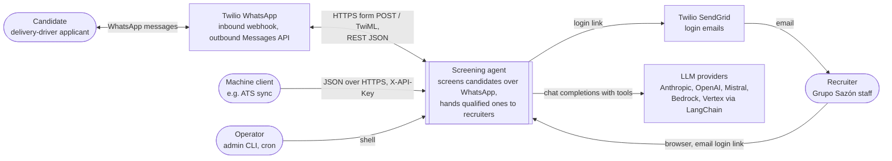
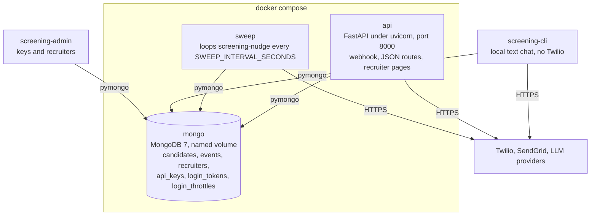
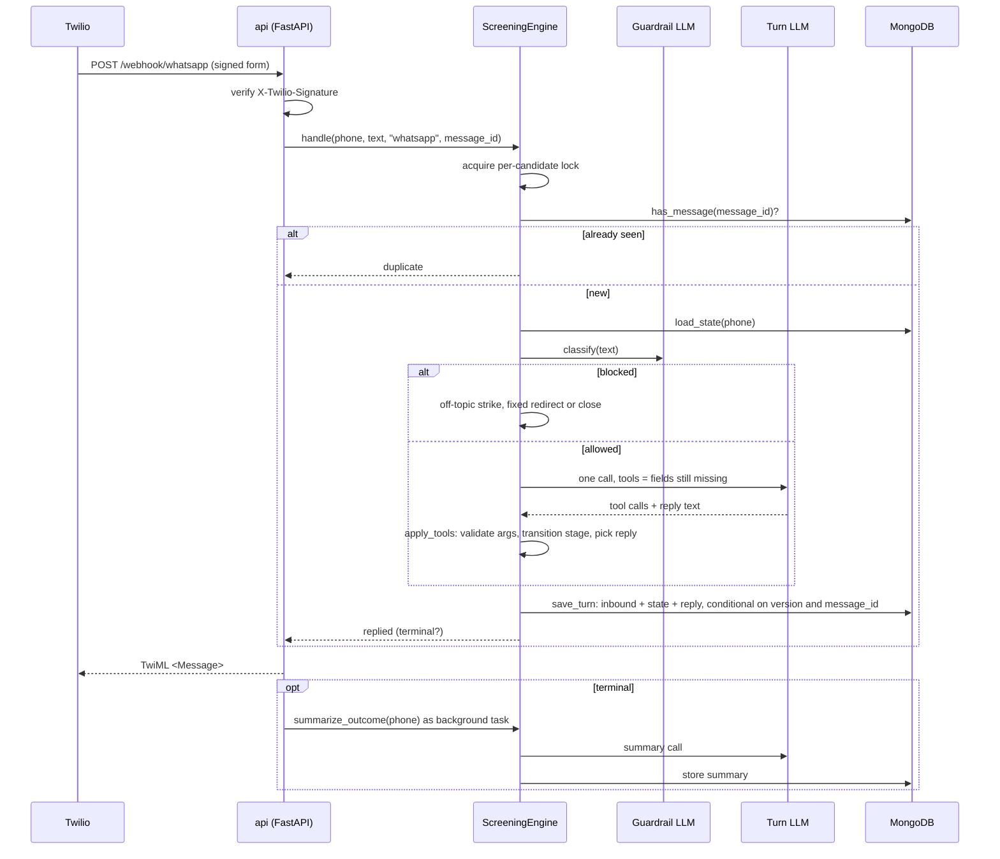

# Grupo Sazón screening agent

AI candidate-screening agent for delivery-driver hiring, plus a recruiter API and recruiter pages. Take-home for Orbio.

Documents:

- `docs/process-design.md`: the Phase 1 process design (stages, validation, outcomes, tone).
- `docs/STATUS.md`: project status, known gaps, open questions and remaining work.
- `docs/Orbio-Assignment.md`: the brief.

## Setup

```bash
python3.12 -m venv .venv
source .venv/bin/activate
pip install -e ".[dev]"            # add ,evals for the OpenAI and Mistral bake-off candidates
export PROJECT_ANTHROPIC_API_KEY=... # Anthropic models; not ANTHROPIC_API_KEY, which Claude Code reads
export SCREENING_DEV_MODE=true      # local only: lets the API run without the secrets below
export SCREENING_SESSION_SECRET=...        # signs the recruiter session cookie, see below
export SCREENING_RECRUITER_EMAIL_DOMAINS='["gruposazon.com"]'   # who may log in
export SCREENING_SENDGRID_API_KEY=SG...    # login links go out through Twilio SendGrid
export SCREENING_LOGIN_EMAIL_FROM=...      # a sender verified in SendGrid
export SCREENING_PUBLIC_URL=https://...    # base URL of every login link; required outside dev mode
export SCREENING_TWILIO_AUTH_TOKEN=...     # verifies X-Twilio-Signature on the webhook
export SCREENING_TWILIO_WEBHOOK_URL=...    # the exact URL set in the Twilio console, see below
export SCREENING_TWILIO_ACCOUNT_SID=...    # outbound: opener and nudges, used in the Messages URL
export SCREENING_TWILIO_API_KEY_SID=SK...  # outbound REST auth (API key, not the auth token)
export SCREENING_TWILIO_API_KEY_SECRET=...
export SCREENING_TWILIO_WHATSAPP_FROM=+14155238886
export SCREENING_TWILIO_OPENER_CONTENT_SID=HX...   # approved opener template; plain text fallback in sandbox
export SCREENING_DATABASE_URL=mongodb://localhost:27017/screening
```

Docker: copy `.env.example` to `.env`, fill the secrets, then `docker compose up --build`. The stack runs the API on port 8000, a sweep loop and MongoDB with a named volume. Tests also need Docker: pytest starts a throwaway `mongo:7` container and skips the repository-backed tests when no Docker socket is present.

Configuration is read from `SCREENING_*` environment variables or `.env`. See `screening_agent/config.py` for every setting and its default.

### Recruiter login

Recruiters do not get a password or a key. They type their work email at `/recruiter/login` and click the link that arrives. Any address at a domain in `SCREENING_RECRUITER_EMAIL_DOMAINS` enrolls itself on first login. The recruiter row is created when the link is used. The link works once and expires after `SCREENING_LOGIN_LINK_MINUTES` (default 15). It always points at `SCREENING_PUBLIC_URL`, never at the request's `Host` header, which a caller can forge. Only dev mode falls back to the request URL. Each address gets one email per `SCREENING_LOGIN_EMAIL_COOLDOWN_SECONDS` (60) and each client IP at most `SCREENING_LOGIN_REQUESTS_PER_IP` (30) per `SCREENING_LOGIN_IP_WINDOW_MINUTES` (60). Behind a proxy, set uvicorn's `FORWARDED_ALLOW_IPS` so the limit sees the caller and not the proxy. A throttled request and a mail-provider failure both answer "check your inbox". The session cookie lasts `SCREENING_SESSION_HOURS` (default 12) and is signed with `SCREENING_SESSION_SECRET`, which is the one secret this app owns. Generate it once:

```bash
python -c "import secrets; print(secrets.token_urlsafe(32))"
```

Without SendGrid credentials in dev mode, the login link is printed to the server log.

### Machine clients and admin

Machine clients send a per-client key in the `X-API-Key` header. Mint, list and revoke keys and manage recruiters with the admin CLI:

```bash
screening-admin create-api-key ats-sync   # prints the key once
screening-admin api-keys
screening-admin revoke-api-key <key id>
screening-admin recruiters
screening-admin deactivate ana@gruposazon.com
```

Every override event records who did it (`recruiter:<email>` or `api_key:<label>`).

### Twilio webhook

`SCREENING_TWILIO_WEBHOOK_URL` is the public URL you type into the Twilio console as the WhatsApp sender's "when a message comes in" webhook, for example `https://<your-tunnel-host>/webhook/whatsapp`. Twilio signs that exact string. Set it when the app sees a different URL than Twilio called, which is the case behind a tunnel or reverse proxy, including the Docker stack behind ngrok. Leave it empty when Twilio reaches the app directly at the URL it signed.

## Run

```bash
screening-cli                        # text chat against the screening flow
uvicorn screening_agent.api.app:app  # webhook, candidates, analytics, recruiter pages at /recruiter/
screening-nudge                      # silence sweep for cron: nudges, then abandons
pytest                               # unit and flow tests, no LLM calls
python -m evals.run_evals            # persona evals against the configured models, PASS/FAIL per persona
python -m evals.run_evals --models anthropic:claude-sonnet-5-5,openai:gpt-6.1-sol,mistralai:mistral-medium-latest \
    --guardrail-models anthropic:claude-haiku-5-5,openai:gpt-6-luna --judge --report docs/bakeoff.md
ruff check . && ruff format .
```

## HTTP surface

| Route | Auth | Purpose |
| --- | --- | --- |
| `POST /webhook/whatsapp` | Twilio signature | Inbound candidate message. Answers TwiML with the reply. |
| `POST /candidates` | recruiter | Opens a conversation and sends the opener. Candidate id is the E.164 phone. |
| `GET /candidates` | recruiter | Candidate list. |
| `GET /candidates/{id}` | recruiter | Profile, summary, transcript and events. |
| `PATCH /candidates/{id}` | recruiter | Outcome override. Writes a `recruiter_override` event with the actor. |
| `GET /analytics` | recruiter | Funnel counts. |
| `/recruiter/...` | session cookie | Server-rendered pages: login, candidate table with filters and funnel, detail with override form. |

"recruiter" means a session cookie or an `X-API-Key`. Routes answer 503 until their secrets are configured, unless `SCREENING_DEV_MODE` is on. Page routes answer 303 to login instead of 401.

## Architecture

The section follows the [C4 model](https://c4model.com): system context, then containers, then one runtime view. Stage order, validation rules and outcomes are design, owned by `docs/process-design.md`.

### System context

Who talks to the system and what it depends on.



The candidate never talks to the system directly. Twilio delivers each WhatsApp message as a signed form POST and relays the TwiML reply. Recruiters use a browser. Machine clients use the same JSON routes with a per-client key. Operators mint keys and manage recruiters with `screening-admin` and run the silence sweep from cron or the `sweep` container.

### Containers

Runnable units as deployed by `compose.yaml`, plus the two local processes.



`api` and `sweep` run the same image and the same `ScreeningEngine`. They share no memory. Each process serialises one candidate with a local lock, and the candidate document's `version` field arbitrates between processes: a write from a stale version fails, the webhook re-runs its turn once, the sweep skips that candidate. No queue, no replica set, no transactions across documents.

### Runtime view: one inbound WhatsApp message



What the diagram fixes in place:

- One LLM turn per message. The guardrail is a second, cheaper call that runs first and fails open.
- The graph is two nodes, `turn` and `apply_tools`, invoked once per message with no checkpointer. State lives in the candidate document, not in LangGraph.
- Inbound message, new state and reply are written together. A crash before the write leaves no trace, so Twilio's retry is processed as new.
- The summary never delays the reply. It runs after the response is sent and outside the lock.

The sweep is the other entry point. `screening-nudge` reads every open conversation, applies the pure `silence_action` policy, then nudges through Twilio or sets `abandoned`, each under the same per-candidate lock and version check. See `flow/silence.py` for the thresholds.

### Components

| Package | Responsibility | Depends on |
| --- | --- | --- |
| `domain/` | `CandidateProfile` with every validation rule, enums, service-area matching, language detection, candidate-local clock. No I/O. | nothing |
| `flow/` | `ScreeningEngine` (entry point for all channels), the two-node LangGraph, tool gating, transitions, fixed replies, silence policy. | `domain`, `llm`, `storage` |
| `llm/` | `chat_model` constructor and provider table, turn prompt, guardrail classifier, summary. The only place a provider is constructed (`init_chat_model` in `llm/models.py`). | `domain`, `flow.state` |
| `storage/` | `Repository` over pymongo: candidate document, events, recruiters, API keys, login tokens and throttles. All atomic writes live here. | `domain`, `flow.state`, `flow.silence` |
| `channels/` | Adapters: Twilio WhatsApp inbound parsing and outbound REST, SendGrid email, the three CLIs. | `flow`, `storage`, `api.auth` |
| `api/` | FastAPI app, auth (`Principal` from session JWT or API key), fail-closed dependencies, webhook signature check. | `flow`, `storage`, `channels` |
| `recruiter/` | Jinja2 pages mounted at `/recruiter`, no JavaScript. Login form, table, detail, override form. | `api`, `storage`, `channels.email` |
| `evals/` | Scripted personas, code graders, LLM judge, guardrail set, bake-off report. Not shipped in the image. | `flow`, `llm` |

`domain` imports only `config`. `flow.state` is the shared state type, imported by `llm` and `storage` as well as `flow`, so the engine, the prompt and the repository agree on one shape. Nothing in `domain`, `flow`, `llm` or `storage` knows which channel it serves.

## Key design decisions

- **One LLM call per candidate message.** The model calls a recording tool and writes its reply in the same turn. Code validates the tool arguments, advances the stage, and swaps the tool set.
- **Structural guardrails.** The model cannot ask about experience before the licence check because that tool is not exposed yet.
- **Code-owned closing messages.** Re-asks, confirmations, disqualifications and the qualified message are fixed text per language, so compliance wording never depends on the model.
- **Two automated stops only.** No licence and out of service area. Everything ambiguous goes to `needs_recruiter_review`.
- **Idempotent inbound.** A redelivered webhook returns `duplicate` and a failed turn is retried as new, so Twilio retries are safe. Mechanism in Architecture, runtime view.
- **Tool gating is enforced twice.** Only the current stage's tools are bound to the model, and a call to any other tool is rejected when applied. Allowed tools are recomputed after each accepted call, so one message can answer several questions. Model misuse of a tool re-asks the current question and is never counted against the candidate.
- **Candidate-local dates.** "Today" for start dates and the prompt is the calendar day in the candidate's service-area timezone, not the server's.
- **One document per candidate.** Chosen so a turn is one atomic write with no replica set or transaction. Mechanism in Architecture, containers.
- **Fail-closed API.** Recruiter routes and the webhook return 503 until their secrets are configured, unless `SCREENING_DEV_MODE` is on. The summary LLM call runs as a background task after the reply.
- **People log in by email, machines by key.** The recruiter pages are plain HTML forms on the API app. Login is a one-time emailed link. The cookie is a signed, expiring session, not a secret, and deactivating a recruiter ends it on the next request. JSON routes accept that cookie or a per-client `X-API-Key` whose hash lives in MongoDB. Nothing is pasted or shared.
- **Guardrail fails open.** One structured-output classification before each turn. A classifier outage allows the message and logs an event. It never blocks a candidate.
- **Silence is a cron sweep.** No long-lived timers, so a restart loses nothing and the policy is a pure function over stored timestamps. Mechanism in Architecture, runtime view.
- **Provider is configuration.** `SCREENING_LIVE_MODEL`, `SCREENING_SUMMARY_MODEL` and `SCREENING_GUARDRAIL_MODEL` take any `provider:model` id supported by LangChain. `llm/models.py` is the single constructor. Provider keys come from settings, so `.env` works outside Docker too: `PROJECT_ANTHROPIC_API_KEY`, `OPENAI_API_KEY`, `MISTRAL_API_KEY`. A missing key fails closed, so a shell `ANTHROPIC_API_KEY` is never billed by accident. Anthropic ids get no sampling parameters, OpenAI and Mistral run at temperature 0, Bedrock and Vertex use their cloud credentials.
- **Evals grade outputs, the judge grades words.** Personas are scripted turns because the stage order is fixed. Code graders check the final JSON, outcome, turn count and reply style (one question, one emoji, length, language). A fixed Haiku judge scores tone and summary usefulness so the bake-off compares models on the same yardstick.
