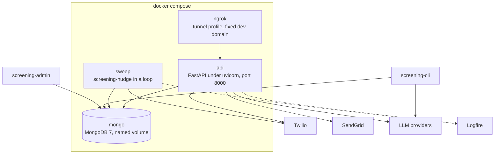
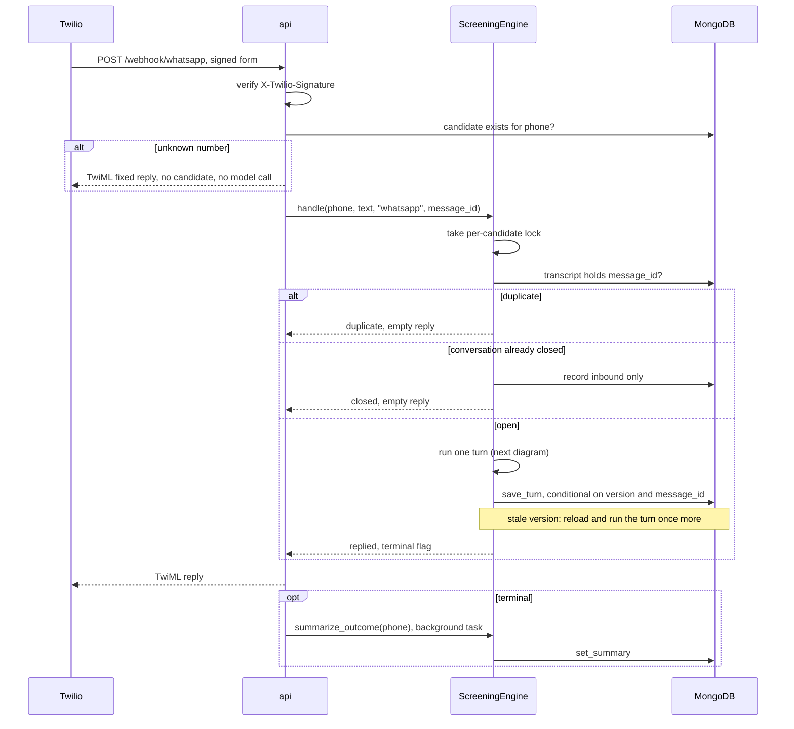
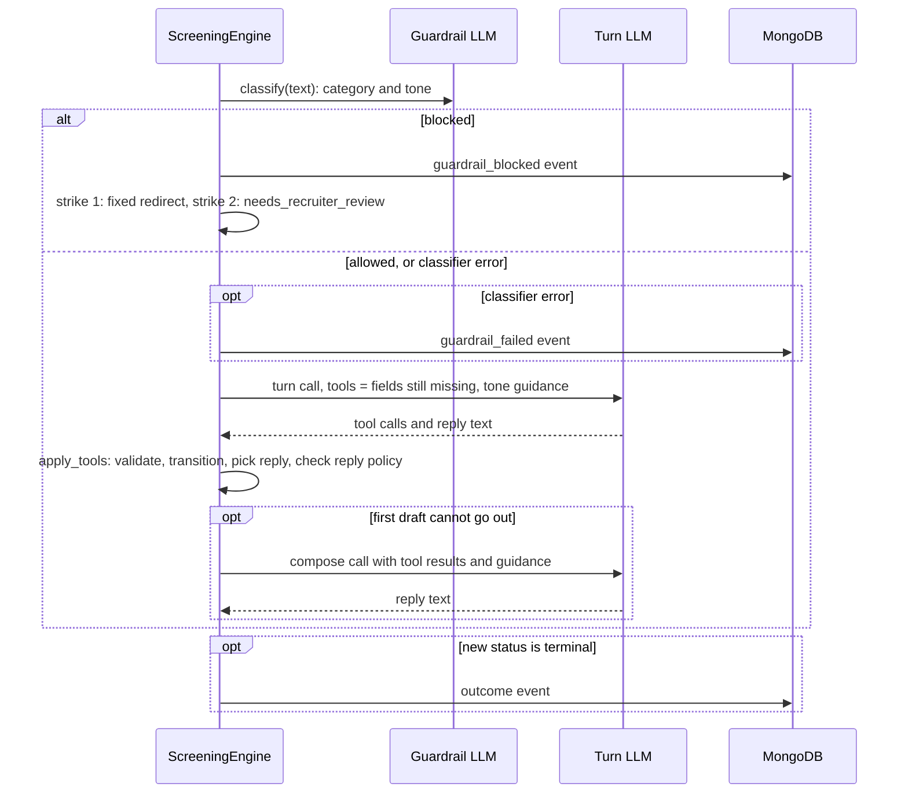
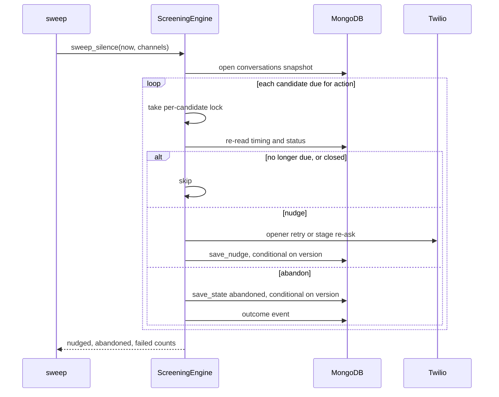

# Grupo Sazón screening agent

AI candidate-screening agent for delivery-driver hiring, plus a recruiter API and recruiter pages. Take-home for Orbio.

Documents:

- `docs/Assignment.md`: the brief.
- `docs/process-design.md`: the Phase 1 process design (stages, validation, outcomes, tone) and the items designed but not built, with rationale and tradeoffs.
- This README: the system as built, design decisions, LLM choice, deployment and improvements.
- `TROUBLESHOOTING.md`: demo runbook, commands run, common failures and tech debt.

## Overview

Grupo Sazón hires delivery drivers in Spain and Mexico and receives about 1,000 applications a week. Recruiters spend most of their phone time on people who cannot be hired. This system does the first pass over WhatsApp and hands recruiters only candidates who passed two objective checks: a valid driving licence and a home city with a Grupo Sazón restaurant.

A recruiter, or the company's hiring software, registers a candidate's phone number (`POST /candidates` or `screening-admin start-from-file`). The link from the application form is treated as makes registration an external step (candidates are seeded for the demo). The candidate then gets a WhatsApp message from an assistant called Sazón, the opener. The opener is fixed text: it says the assistant is an AI, that the chat is recorded, who sees it and how to stop, and asks for permission to continue. The assistant then asks seven short questions, one at a time. The conversation ends in one of four results. The outcome message asks whether the candidate has questions about the job for the recruiter, records one reply, and closes. Recruiters see the result, a summary, anything flagged for a check, the candidate's questions, the full chat and every decision the system made on the recruiter pages.

The model talks and the code decides:

- **The model** reads each message in Spanish or English, writes a short reply and fills in the form fields the message answers. A second, smaller model call first checks that the message is about the application.
- **The code** owns the form, the question order, the validity rules, the four results and every message that matters legally. The model sees only the tools for the next open question, so the code enforces the order, not the prompt.

### The four results

| Result | Who decides | What the candidate hears |
| --- | --- | --- |
| Qualified | Code, when every answer is valid and nothing was flagged | Their answers go to a recruiter, who will be in touch about next steps. Nothing about the job is promised. |
| Not qualified | Code, only for no licence or no restaurant nearby | The real reason, and that the application stays on file. |
| Needs a recruiter | Code, when the candidate says no to consent, anything is unclear, or the agent flagged something to check (a criminal record, an unconfirmed licence, a documents question, a hedged answer) | A recruiter will follow up. |
| Abandoned | Code, after a long silence | Nothing further. |

Only two facts cause an automatic no. Everything that needs judgement goes to a person. A recruiter can change any result from the recruiter web page, and the change is logged with their name.

### Coverage of the brief

| Brief item | Status | Where |
| --- | --- | --- |
| Screening agent: structured JSON, validation, history, storage, summary, error handling | Built | How it works, Architecture |
| Recruiter tracking tool | Built: pages and JSON API | HTTP surface |
| LLM choice, justified | Done | LLM choice |
| Multi-language, guardrails, sentiment | Built: Spanish or English per message, guardrail classifier with tone | Key design decisions |
| Re-engagement | Built: silence sweep with nudges, then abandon | How it works |
| Tests and evals | Built: pytest with a scripted fake model, persona evals, model bake-off (no valid run yet) | LLM choice |
| Analytics | Partial: funnel counts only | Potential improvements |
| Deployment and scaling design | Designed | Deployment and scaling |
| ATS integration | Design note only | Potential improvements |
| Voice, interview scheduling, RAG over a FAQ | Not built | |

### What is not built yet

The voice-call channel, the silence scheduler inside the API, the recruiter console, the public intake page and the queue-backed worker are not built. Each has its rationale and tradeoffs in `docs/process-design.md` ("Designed, not built"). SMS is dropped. Candidate ids that are not phone numbers are built on the `guid-candidate-ids` branch and merge after the demo take. The list of restaurant cities is sample data, not the client's real list of 45 locations. The test that compares AI models has not produced a valid run yet (see LLM choice).

## Quick start

Needs Python 3.12, Docker and an Anthropic API key.

```bash
python3.12 -m venv .venv && source .venv/bin/activate
pip install -e ".[dev]"
export PROJECT_ANTHROPIC_API_KEY=...     # not ANTHROPIC_API_KEY, which Claude Code reads
docker run -d --name screening-mongo -p 27017:27017 mongo:7   # the default SCREENING_DATABASE_URL
screening-cli                            # chat with the agent in the terminal
pytest                                   # no LLM calls; starts its own throwaway mongo:7
```

For the full stack (API, recruiter pages, sweep, MongoDB), copy `.env.example` to `.env`, fill the secrets and run `docker compose up --build`. Configuration lists every setting.

## Sample conversations

Two live WhatsApp screenings from the 27 October preflight on the Twilio sandbox, as the recruiter page shows them. The names are the test names the candidates typed. The inspector column is the reply source from each turn record. In both runs the live model returned its tool call with no text, so every reply was the fixed next question or the closing message. The prompt has since been changed to state the question order and the output format. In the 28 October run the model wrote its own text on the first turn, a question about how it knew the name, and returned tool-only calls on the next three. The inspector shows which source each reply had.

Disqualified, outside the service area, four turns:

| Who | Message | Inspector |
|---|---|---|
| agent | Hi! I'm Sazón, the AI assistant for Grupo Sazón. We received your delivery-driver application and this conversation is recorded. Is now a good moment for a few quick questions? | opener |
| candidate | Yes | `record_consent` accepted |
| agent | I didn't catch your name. Could you give me your full name? For example: Ana García López. | fixed next question |
| candidate | Brittany Walker | `record_full_name` accepted |
| agent | Just to confirm: do you have a valid driving licence? Yes or no. | fixed next question |
| candidate | Yes | `record_licence` accepted |
| agent | Which city do you live in? I'll check if we have a restaurant nearby. | fixed next question |
| candidate | Dallas | `record_zone` accepted, no service area, `disqualified` |
| agent | Thanks for your time. We don't have a restaurant in your area right now, so we can't move forward. We'll keep your application on file in case we open nearby. | fixed closing message |

Summary written for the recruiter: "Disqualified because Grupo Sazón has no restaurant in Dallas, where the candidate lives; the decision rests on location, not on licence or experience."

Qualified, eight turns:

| Who | Message | Inspector |
|---|---|---|
| agent | Hi! I'm Sazón, the AI assistant for Grupo Sazón. We received your delivery-driver application and this conversation is recorded. Is now a good moment for a few quick questions? | opener |
| candidate | Sure | `record_consent` accepted |
| agent | I didn't catch your name. Could you give me your full name? For example: Ana García López. | fixed next question |
| candidate | Donald Portsmith | `record_full_name` accepted |
| agent | Just to confirm: do you have a valid driving licence? Yes or no. | fixed next question |
| candidate | Yep | `record_licence` accepted |
| agent | Which city do you live in? I'll check if we have a restaurant nearby. | fixed next question |
| candidate | Mexico City | `record_zone` accepted as Ciudad de México |
| agent | What availability do you have: full-time, part-time, or weekends? | fixed next question |
| candidate | I can only do weekends | `record_availability` accepted |
| agent | Which shift do you prefer: morning, afternoon, evening, or flexible? | fixed next question |
| candidate | Im flexible as long as its weekends only | `record_schedule` accepted |
| agent | How many years of delivery experience do you have, and on which platforms? Say 0 if none. | fixed next question |
| candidate | Ive been with Uber Eats for 3 years | `record_experience` accepted |
| agent | When could you start? Give me a date, for example 3 November. | fixed next question |
| candidate | November 7th is the soonest | `record_start_date` accepted, `qualified` |
| agent | All set, Donald! You meet what we're looking for. A recruiter will message you to book a short interview. | fixed closing message |

Profile JSON for the qualified candidate:

```json
{"full_name": "Donald Portsmith", "has_licence": true, "zone": "Ciudad de México", "availability": ["weekends"], "schedule": "flexible", "experience_years": 3, "experience_platforms": ["Uber Eats"], "start_date": "2026-11-07"}
```

Summary written for the recruiter: "Qualified: meets the screening criteria for Mexico City, with a valid licence, 3 years of Uber Eats experience, and a start date of 7 November 2026." The third line of the summary asks the recruiter to confirm the licence, since the candidate answered only "Yep" and no document was checked.

## How it works

How a conversation runs, step by step. The Architecture section covers the same system in diagrams.

### The questions, in order

The questions run cheapest disqualifier first. The two hard stops come before any detail a recruiter would read.

| Step | Question | What can happen |
| --- | --- | --- |
| 1 | Do you agree to continue? (consent) | Only a clear yes continues. "Not now" waits. A clear no stops the chat and a recruiter follows up. A bare "no" is asked about: not now, or not at all? |
| 2 | Full name | Unclear: asked again once, with an example. |
| 3 | Valid driving licence? | No: not qualified. The candidate hears the real reason. |
| 4 | Which city? | No restaurant there: not qualified. Close match: the assistant asks "Do you mean X?" first. |
| 5 | Availability (full-time, part-time, weekends) | Unclear: asked again once. |
| 6 | Preferred shift | Unclear: asked again once. |
| 7 | Delivery experience | Zero is a valid answer. |
| 8 | Start date | A past date: asked again once. |

A candidate who answers several questions in one message skips ahead. The code accepts every answer it can match and moves to the first question still open.

### What happens to one message

1. Twilio forwards the candidate's WhatsApp message. The system verifies the Twilio signature and rejects a forged message. The check is active in the production configuration; dev mode can run without it.
2. A message already handled is ignored. Twilio redelivers a message when it gets no answer.
3. A small, fast AI check decides whether the message is about the application and reads the candidate's tone: neutral, confused or frustrated. Off-topic or abusive messages get one polite redirect, and a second closes the chat for recruiter review. If the check itself fails, the message goes through with neutral tone.
4. The main model reads the message with the open questions in front of it, fills in the matching fields and drafts a reply. A confused or frustrated candidate gets a calmer, simpler instruction for that turn.
5. The code validates each answer. A valid answer is recorded and the next question is prepared. An invalid answer is rejected with a reason, and two invalid answers to the same question send the candidate to a recruiter instead of looping. A candidate who asks to stop goes to a recruiter and hears nothing more.
6. The code decides what the reply must say, and the AI says it. Closing messages are fixed text, so a rejected candidate always hears the true reason. For every other turn the code writes a one-line brief: carry on, or ask again because the answer was rejected for this reason, or confirm this city or this name, or say the chat waits. If the AI's first draft already fits (every answer accepted, nothing to confirm, passes the reply rules), it goes out as is. Otherwise the AI is called once more with the results and the brief. The reply rules apply to both texts: one question, at most one emoji, short, no formatting or links, in the candidate's language. If the AI writes nothing, breaks a rule or the call fails, the fixed question for the step goes out. The recruiter page shows which happened.
7. The message, the updated form, the reply and a record of why the system replied as it did are saved as one unit, before the reply is delivered. If the system crashes halfway, nothing is recorded, and the copy Twilio sends again is handled as new. If delivery then fails, the form has moved on and the candidate hears nothing until the two-hour nudge repeats the open question.
8. The reply goes back through Twilio. When the result is final, the system then writes a short summary for the recruiter, so the candidate never waits for it.
9. The outcome message ends by asking whether the candidate has questions about the job for the recruiter. One more reply is read, the questions are recorded for the recruiter, a fixed thank-you closes the chat and the summary is written again with them. A candidate who declined consent or asked to stop is not asked; their chat closes at once.

Each candidate message costs one main AI call, a second when the first draft cannot go out (step 6), plus the small check in step 3.

### When a candidate goes quiet

No timer runs inside the system. A separate task, called the sweep, wakes every few minutes and looks at the saved times of the last messages.

- No answer to the first message: the opener is sent again after about one day. After two days the candidate is marked abandoned.
- Silence after the chat has started: a nudge after about two hours and a last nudge after about twenty-three hours. After a day the candidate is marked abandoned, and the recruiter sees which question they stopped at.

The nudge repeats the open question. If the candidate replies while the sweep is sending a nudge, the candidate may still receive that nudge, but the saved record keeps the candidate's reply and drops the nudge.

### Where the information lives and who can see it

Each candidate is one record in the database: their answers, the result, the full chat and the timing. Every result, override, blocked message and failed nudge or summary is also written to a separate log that is only added to, apart from the demo reset described under Key design decisions. Each answered message also carries a decision record explaining why the system replied as it did. When tracing is on, timing and cost data goes to Logfire, a monitoring service. No message text, phone number or email goes there. A failure of the main AI call is not logged there; it shows up as an error and the message is handled again when Twilio resends it.

Recruiters log in with an emailed one-time link (see Recruiter login). Other software, for example the company's hiring system, uses its own access key. Every change to a result records who made it.

## Architecture

The section follows the [C4 model](https://c4model.com): system context, then containers, then two runtime views. Stage order, validation rules and outcomes are design, owned by `docs/process-design.md`.

### System context

Who talks to the system and what it depends on.


| Actor or system | Role |
| --- | --- |
| Candidate | Delivery-driver applicant. Only ever talks to Twilio. |
| Recruiter | Grupo Sazón staff. Browser plus an emailed one-time login link. |
| Machine client | For example an ATS sync. Same JSON routes, per-client key. |
| Operator | Mints keys and manages recruiters with `screening-admin`, runs the sweep from cron or the `sweep` container. |
| Twilio WhatsApp | Delivers each message as a signed form POST, relays the TwiML reply, carries outbound openers and nudges over the Messages REST API. |
| Twilio SendGrid | Sends the login email. |
| LLM providers | Anthropic, OpenAI and Mistral through the provider table. Bedrock and Vertex only through LangChain's `init_chat_model`. |

### Containers

Runnable units as deployed by `compose.yaml`, plus the two local processes. `ngrok` runs only under the `tunnel` profile. Edges to external services show what each process actually calls.



| Process | Serves | Calls out to |
| --- | --- | --- |
| `api` | Webhook, JSON routes, recruiter pages | Twilio (TwiML, Messages API), SendGrid (login email), LLM providers (turn, guardrail, summary), Logfire when `SCREENING_LOGFIRE_TOKEN` is set |
| `sweep` | Silence policy every `SWEEP_INTERVAL_SECONDS` | Twilio, and Logfire when the token is set. Nudge text is a fixed template and `abandoned` gets no summary call. |
| `mongo` | Collections `candidates`, `events`, `recruiters`, `api_keys`, `login_tokens`, `login_throttles` | nothing |
| `ngrok` | Public HTTPS at `NGROK_URL`, forwarded to `api:8000`; local inspector on `127.0.0.1:4040` | ngrok's edge |
| `screening-cli` | Local text chat | LLM providers only. No Twilio. |
| `screening-admin` | Keys and recruiter accounts | nothing |

`api` and `sweep` run the same image and the same `ScreeningEngine`. They share no memory. Each process serialises one candidate with a local lock, and the candidate document's `version` field arbitrates between processes: a write from a stale version fails, the webhook re-runs its turn once, the sweep skips that candidate. No queue, no replica set, no transactions across documents.

### Runtime view: one inbound WhatsApp message

Two diagrams. The first is the request path, the unknown-number check and the three outcomes `handle` can return. The second is the inside of one turn.





What the diagrams fix in place:

- The guardrail is a second, cheaper call that runs first and fails open. The turn adds a `compose` call only when the first draft cannot go out.
- The graph has three nodes, `turn`, `apply_tools` and `compose`, invoked once per message with no checkpointer. State lives in the candidate document, not in LangGraph.
- Each step is a span (`handle`, `guardrail`, `turn`, `summary`, `sweep`, `nudge`) with metadata only. Candidate ids are removed from URLs, and exception messages never name the candidate, because Logfire does not scrub exception text or URL attributes.

### Runtime view: silence sweep



`silence_action` in `flow/silence.py` is a pure decision over stored timestamps and holds the thresholds. A failed send is isolated to that candidate as a `nudge_failed` event. A stale version on save means the candidate replied while the sweep ran. Their turn wins and the sweep logs `nudge_unrecorded` instead.

### Components

| Package | Responsibility | Depends on |
| --- | --- | --- |
| `domain/` | `CandidateProfile` with every validation rule, enums, service-area matching, language detection, candidate-local clock. No I/O. | nothing |
| `flow/` | `ScreeningEngine` (entry point for all channels), the two-node LangGraph, tool gating, transitions, fixed replies, silence policy. | `domain`, `llm`, `storage` |
| `llm/` | `chat_model` constructor and provider table, turn prompt, guardrail classifier, summary. The only place a provider is constructed (`init_chat_model` in `llm/models.py`). | `domain`, `flow.state` |
| `storage/` | `Repository` over pymongo: candidate document, events, recruiters, API keys, login tokens and throttles. All atomic writes live here. | `domain`, `flow.state`, `flow.silence`, `flow.turn_record` |
| `channels/` | Adapters: Twilio WhatsApp inbound parsing and outbound REST, SendGrid email, the three CLIs. | `flow`, `storage`, `api.auth` |
| `api/` | FastAPI app, auth (`Principal` from session JWT or API key), fail-closed dependencies, webhook signature check. | `flow`, `storage`, `channels` |
| `observability.py` | Logfire configuration, URL and contact redaction, keyed candidate hash. Engine spans use the OpenTelemetry API, so nothing is traced until the API or `screening-nudge` configures Logfire. | `config` |
| `recruiter/` | Jinja2 pages mounted at `/recruiter`, with one polling script on the candidate page. Login form, table, detail, override form. | `api`, `storage`, `channels.email` |
| `evals/` | Scripted personas, code graders, LLM judge, guardrail set, bake-off report. Not shipped in the image. | `flow`, `llm` |

`domain` imports only `config`. `flow.state` is the shared state type, imported by `llm` and `storage` as well as `flow`, so the engine, the prompt and the repository agree on one shape. Nothing in `domain`, `flow`, `llm` or `storage` knows which channel it serves.

## Key design decisions

- **One or two LLM calls per candidate message.** The first call records with tools and drafts a reply. Code validates the arguments, advances the stage and swaps the tool set. When the draft cannot go out (a rejected answer, a pending confirmation, no text, a broken reply rule) a second call with the tool results and a one-line brief writes the message. The brief, not the template, is what the model follows, so the templates are fallbacks and the live runs that returned tool calls with no text now get a model-written question.
- **Tool gating, enforced twice.** The model only sees the tools for fields still missing from the current stage onward, so it cannot ask about experience before the licence check. A call to any other tool is rejected when applied. Allowed tools are recomputed after each accepted call, so one message can answer several questions. Model misuse of a tool re-asks the current question and is never counted against the candidate.
- **Code-owned opener and closing messages.** The opener, disqualifications, review hand-offs, the qualified message and the wrap-up question are fixed text per language (detected per message, Spanish by default), so compliance and opt-in wording never depends on the model. Every channel, `screening-cli` and the evals included, starts a conversation with the same opener; a message from a number with no opener gets no model call. Re-asks and confirmations are model-written from a code brief, with a fixed fallback.
- **Never an automated yes on a judgement call.** A `flag_for_recruiter` tool is exposed after consent. The prompt tells the model to call it, alongside the recording tool, when the candidate mentions a criminal record, a suspended, expired or unconfirmed licence, a work-permit or documents question, or hedges an answer. The answer is still recorded as given and the screening continues, but a complete profile with any flag goes to `needs_recruiter_review` with reason `recruiter_check` instead of `qualified`. The flags are shown on the candidate page and fed to the summary.
- **The summary is structured.** The summary model returns four fields (outcome, profile facts, what to double-check, next step) and code joins them into four lines, so the recruiter page never shows the model's own labels or numbering.
- **Explicit opt-in, and a way out.** The opener says it is an AI and not a person, that the chat is recorded and only the recruiting team sees it, that the candidate can stop at any time by saying so, and asks whether they agree. The model records the answer as `agreed`, `declined`, `not_now` or `unclear`. Only `agreed` opens the screening. "Not now" waits for the candidate. A bare "no" is unclear and is asked about once: not now, or not at all? After consent a `request_stop` tool is always exposed; a stop request closes the chat for a recruiter with reason `stop_requested` and the agent sends nothing more.
- **Idempotent inbound.** A redelivered webhook returns `duplicate` and a failed turn is retried as new, so Twilio retries are safe.
- **Candidate-local dates.** "Today" for start dates and the prompt is the calendar day in the candidate's service-area timezone, not the server's.
- **One document per candidate.** A turn is one atomic write, with no replica set or transaction.
- **Fail-closed API.** Recruiter routes and the webhook return 503 until their secrets are configured, unless `SCREENING_DEV_MODE` is on. Dev mode opens the recruiter routes only while `SCREENING_SESSION_SECRET` is unset, and skips the webhook signature only while `SCREENING_TWILIO_AUTH_TOKEN` is unset. A stray dev-mode flag on a deployment with real secrets opens neither. The login-mail redirect follows the same rule: honoured in dev mode only, 503 from the login form otherwise.
- **People log in by email, machines by key.** Login is a one-time emailed link. The cookie is a signed, expiring session, not a secret. JSON routes accept that cookie, with a CSRF header on writes, or a per-client `X-API-Key` whose hash lives in MongoDB. Nothing is pasted or shared.
- **Every turn explains itself.** The inbound transcript entry carries a turn record: stage before and after, guardrail category, tools exposed and called, why each call was accepted or rejected, where the reply came from, the model text a template replaced, tokens, latency and the trace id. It is written in the same update as the turn, so a turn that is not saved leaves no record. The recruiter candidate page shows it under every answered message.
- **The application name is checked, never trusted.** `POST /candidates` may carry the applicant name. The opener greets by first name and the prompt knows it, but the candidate is still asked for their name. When the two differ below `SCREENING_NAME_MATCH_THRESHOLD` (0.8, token-set ratio after casefold and accent strip), the stated name is held out of the profile, the agent asks whether they are the applicant, written by the model from a code brief with a fixed fallback, with a `confirm_name` tool, and a no goes to `needs_recruiter_review` with reason `name_mismatch`. The applicant name is stored on the document, shown on the recruiter pages, and kept out of logs and traces like every other personal field.
- **Unknown numbers get a fixed reply, not a screening.** The webhook answers a number with no application with one bilingual message that names the assistant, says it is an AI and says no application was found. No candidate is stored and no model call runs, so the first message a candidate ever receives is the opener with its disclosure and strangers cannot spend model calls.
- **Demo reset archives, never deletes.** A recruiter can reset a candidate whose id is in `SCREENING_DEMO_PHONES`, an allowlist separate from dev mode so no real candidate can be reset. The document and its events move under a new id (`<phone>~<suffix>`) with `archived_at` and `archived_by`, and a `demo_reset` event records the actor. Standalone Mongo has no transactions, so the move is a fenced, idempotent sequence that commits on a version-keyed delete. A turn that lands mid-move makes the delete miss and the sequence repeats, at most three times, then fails with the live candidate untouched. A crash right after the delete leaves the events under the old id until the next reset of that id. Archived copies are hidden from the list, the funnel and the sweep, and stay readable at their own page.
- **Silence is a cron sweep.** No long-lived timers, so a restart loses nothing and the policy is a pure function over stored timestamps.
- **Provider is configuration.** `SCREENING_LIVE_MODEL`, `SCREENING_SUMMARY_MODEL` and `SCREENING_GUARDRAIL_MODEL` take any `provider:model` id supported by LangChain. `llm/models.py` is the single constructor. Provider keys come from settings, so `.env` works outside Docker too: `PROJECT_ANTHROPIC_API_KEY`, `OPENAI_API_KEY`, `MISTRAL_API_KEY`. A missing key fails closed, so a shell `ANTHROPIC_API_KEY` is never billed by accident. Anthropic and OpenAI ids get no sampling parameters, Mistral runs at temperature 0, Bedrock and Vertex use their cloud credentials.
- **Evals grade outputs, the judge grades words.** Personas are scripted turns because the stage order is fixed. Code graders check the final JSON, outcome and turn count. Reply style uses the same rules as the live reply policy (`flow/reply_policy.py`), applied to the raw model text, not to the fixed question that replaced it. The report shows the policy fallback rate per model. A fixed Haiku judge scores tone and summary usefulness so the bake-off compares models on the same yardstick.
- **The bake-off fails loudly.** The run exits 1 when any persona fails or any scored guardrail classifier is below `--guardrail-min-accuracy` (default 0.9) or above `--guardrail-max-latency-seconds` at p95 (default 2.5), or below `--tone-min-accuracy` on the candidate-tone cases (default 0.8). An unavailable classifier scores zero and fails. Every turn, summary, guardrail and judge model id is constructed before the first paid call, so a missing key or unknown provider is a usage error, not a lost run. Eval databases live on `SCREENING_EVAL_DATABASE_URL` (default local Mongo), never on the app's `SCREENING_DATABASE_URL`. `--out` writes `bakeoff.json` (the results contract, with a `schema_version`) and `bakeoff.html`. The HTML report has no JavaScript and loads its fonts from Google Fonts, with system fallbacks. Rebuild the report from the JSON with `python -m evals.render_report`. Cost per screening averages only personas that finished without an error, and a model with no replies shows n/a. p95 is the inclusive percentile over answered classifier calls, so failed calls never flatter the latency gate.

## LLM choice

Defaults in `screening_agent/config.py`: `anthropic:claude-sonnet-5-5` for the candidate turn, `anthropic:claude-haiku-5-5` for the guardrail classifier and the summary. Any `provider:model` id can replace them by setting.

Why this pair, from design rather than measurement:

- The turn is tool use under constraint. One call must pick the right recording tool, give valid arguments and write a short reply in the candidate's language. Current Claude models follow a bound tool set and a strict reply format reliably, which matters more here than raw reasoning.
- Spanish from Spain and Mexico with slang, typos and code-switching. The judge personas in `evals/` exercise this, and the live reply policy catches a language mismatch, but the base model still has to read "no tengo carnet" and "ps si" correctly.
- Latency is in the chat loop. Haiku runs before every turn as the guardrail and after the last one as the summary. A fast small model keeps these extra calls cheap and without a visible pause.
- One provider for all three roles keeps the key handling, the usage metadata and the error shapes the same.

What the scripted bake-off showed. The run saved in `docs/bakeoff.json` on 27 Oct compared Sonnet, `openai:gpt-6.1-sol` and `mistralai:mistral-medium-3-5` on the persona set. Every Anthropic call answered 400 because the org-level key was sent without the workspace header, and every OpenAI call answered 400 as well. Only Mistral completed. That run does not support a model choice, and the report says so (`docs/bakeoff.html`). The workspace header is now sent from `PROJECT_ANTHROPIC_WORKSPACE_ID`. Re-running the bake-off is the first item under Potential improvements, and the defaults change to the winner when it runs.

What would change the choice: a policy fallback rate above a few percent on Sonnet (the model keeps writing two questions or an emoji), a guardrail accuracy below 0.9 or p95 latency above 2.5 s on Haiku, or a cost per screening that the per-screening budget cannot carry at 1000 applications a week.

## Configuration

```bash
export PROJECT_ANTHROPIC_API_KEY=... # Anthropic models; not ANTHROPIC_API_KEY, which Claude Code reads
# export PROJECT_ANTHROPIC_WORKSPACE_ID=...   # an org-level Anthropic key needs it, sent as the anthropic-workspace-id header
# export OPENAI_API_KEY=...                   # bake-off candidates only
# export MISTRAL_API_KEY=...                  # bake-off candidates only
# export SCREENING_EVAL_DATABASE_URL=mongodb://localhost:27017/screening   # throwaway eval databases; the default
export SCREENING_DEV_MODE=true      # local only: lets the API run without the secrets below
export SCREENING_SESSION_SECRET=...        # signs the recruiter session cookie, see below
export SCREENING_RECRUITER_EMAIL_DOMAINS='["gruposazon.com"]'   # who may log in
export SCREENING_SENDGRID_API_KEY=SG...    # login links go out through Twilio SendGrid
export SCREENING_LOGIN_EMAIL_FROM=...      # a sender verified in SendGrid
# export SCREENING_LOGIN_EMAIL_REDIRECT_TO=...   # dev mode only: every login email goes to this demo inbox
export SCREENING_PUBLIC_URL=https://...    # base URL of every login link; required outside dev mode
# export SCREENING_DEMO_PHONES='["+34600111222"]'   # demo only: candidate ids a recruiter may reset from the console
export SCREENING_TWILIO_AUTH_TOKEN=...     # verifies X-Twilio-Signature on the webhook
export SCREENING_TWILIO_WEBHOOK_URL=...    # the exact URL set in the Twilio console, see below
export SCREENING_TWILIO_ACCOUNT_SID=...    # outbound: opener and nudges, used in the Messages URL
export SCREENING_TWILIO_API_KEY_SID=SK...  # outbound REST auth (API key, not the auth token)
export SCREENING_TWILIO_API_KEY_SECRET=...
export SCREENING_TWILIO_WHATSAPP_FROM=+14155238886
export SCREENING_TWILIO_OPENER_CONTENT_SID=HX...   # approved opener template; plain text fallback in sandbox
export SCREENING_LOGFIRE_TOKEN=...          # tracing; unset means no tracing and nothing sent
export SCREENING_CANDIDATE_HASH_SECRET=... # keys the candidate id in traces; unset, traces carry none
export SCREENING_DATABASE_URL=mongodb://localhost:27017/screening
```

Docker: `docker compose up --build` runs the API on port 8000, a sweep loop and MongoDB with a named volume. `api` and `sweep` bind-mount `./screening_agent` read-only and `api` runs `uvicorn --reload`, so source edits apply without a rebuild. Add `--build` only after a change to `pyproject.toml` or the `Dockerfile`. `--profile tunnel` adds the `ngrok` service (see Twilio webhook).

Configuration is read from `SCREENING_*` environment variables or `.env`. See `screening_agent/config.py` for every setting and its default.

### Recruiter login

Recruiters have no password or key. An admin invites each work address with `screening-admin invite <email>`. The address must be at a domain in `SCREENING_RECRUITER_EMAIL_DOMAINS`; the domain list is a second gate, not the grant.

- **Flow.** The recruiter types the email at `/recruiter/login`, opens the emailed link and presses a button. The GET only shows the button, so a mail scanner that prefetches the link cannot burn it or log in. The POST consumes the token. The link works once and expires after `SCREENING_LOGIN_LINK_MINUTES` (default 15).
- **Link host.** The link always points at `SCREENING_PUBLIC_URL`, never at the request's `Host` header, which a caller can forge. Only dev mode falls back to the request URL.
- **Uniform answer.** An uninvited address, an unknown domain, a deactivated recruiter, a throttled request and a mail-provider failure all get the same "check your inbox" page and send nothing.
- **Throttles.** One email per address per `SCREENING_LOGIN_EMAIL_COOLDOWN_SECONDS` (60). At most `SCREENING_LOGIN_REQUESTS_PER_IP` (30) per client IP per `SCREENING_LOGIN_IP_WINDOW_MINUTES` (60). Behind a proxy or the `ngrok` tunnel, set `FORWARDED_ALLOW_IPS` to the proxy's address so uvicorn trusts its forwarded headers and the limit sees the caller.
- **Session.** The cookie lasts `SCREENING_SESSION_HOURS` (default 12), is signed with `SCREENING_SESSION_SECRET` and is marked `Secure` when `SCREENING_PUBLIC_URL` is https.
- **Revocation.** A timestamp on the recruiter row (`sessions_valid_after`) replaces a token blocklist, so one write invalidates every outstanding cookie. The JWT `iat` is a float, and MongoDB stores `sessions_valid_after` to the millisecond, so a session issued inside the deactivation's millisecond also counts as revoked. `screening-admin deactivate <email>` blocks new links, ends every session issued before it, and works before the address has ever been invited. `reactivate` lifts the block without reviving those sessions. Removing a domain from the allowlist also ends its recruiters' sessions.
- **CSRF.** The override form carries an HMAC of the session cookie. The server keeps no extra state, and a stolen token is useless without the exact cookie it was minted from.

The session secret is the one secret this app owns. Generate it once:

```bash
python -c "import secrets; print(secrets.token_urlsafe(32))"
```

The login pages and the login email are localised by `recruiter/i18n.py`: `es-MX` by default, `es-ES` and `en-US` through the `?lang=` links on the login form, remembered in the `recruiter_lang` cookie, otherwise taken from `Accept-Language`. Pages behind the login stay English.

In dev mode without the SendGrid settings, the login email is written to the process's stderr, which Docker shows in `docker compose logs api`; it is never a log record, so tracing cannot export it. `SCREENING_LOGIN_EMAIL_REDIRECT_TO` delivers every login email to one address instead of the recruiter's, for a demo inbox; it is honoured in dev mode only and the login form answers 503 when it is set outside dev mode.

### Machine clients and admin

Machine clients send a per-client key in the `X-API-Key` header. Mint, list and revoke keys and manage recruiters with the admin CLI:

```bash
screening-admin create-api-key ats-sync   # prints the key once
screening-admin api-keys
screening-admin revoke-api-key <key id>
screening-admin recruiters
screening-admin deactivate ana@gruposazon.com
```

### Seeding a demo from an applicant file

`screening-admin start-from-file applicants/applicants.example.json --dry-run` validates a JSON list of `{name, phone, language}` and prints what it would open. Without `--dry-run` it opens a WhatsApp screening per row through the same path as `POST /candidates`, with the applicant name, and reports a phone that already has a conversation as skipped. The whole file is validated before anything is sent. Put real test candidates in `applicants/applicants.local.json`, which is gitignored.

### Twilio webhook

`SCREENING_TWILIO_WEBHOOK_URL` is the public URL you type into the Twilio console as the WhatsApp sender's "when a message comes in" webhook, for example `https://<your-tunnel-host>/webhook/whatsapp`. Twilio signs that exact string. Set it when the app sees a different URL than Twilio called, which is the case behind a tunnel or reverse proxy, including the Docker stack behind the `ngrok` compose service (`docker compose --profile tunnel up`, with `NGROK_AUTHTOKEN` and `NGROK_URL` set). `NGROK_URL` is the account's fixed ngrok dev domain; set `SCREENING_PUBLIC_URL` and `SCREENING_TWILIO_WEBHOOK_URL` to it. Without the profile no tunnel starts. Leave it empty when Twilio reaches the app directly at the URL it signed.

## Commands

```bash
uvicorn screening_agent.api.app:app  # webhook, candidates, analytics, recruiter pages at /recruiter/
screening-nudge                      # silence sweep for cron: nudges, then abandons
python -m evals.run_evals            # persona evals against the configured models, PASS/FAIL per persona on stderr
python -m evals.run_evals --models anthropic:claude-sonnet-5-5,openai:gpt-6.1-sol,mistralai:mistral-medium-3-5 \
    --guardrail-models anthropic:claude-haiku-5-5,openai:gpt-6-luna,mistralai:mistral-small-2603 \
    --judge --out docs            # bake-off: needs .[evals], all three provider keys and a Mongo; overwrites docs/bakeoff.json and bakeoff.html
python -m evals.render_report docs/bakeoff.json   # rebuild bakeoff.html from saved results, no LLM calls
ruff check . && ruff format .
pyright                              # standard mode, config in pyproject.toml
```

## HTTP surface

| Route | Auth | Purpose |
| --- | --- | --- |
| `POST /webhook/whatsapp` | Twilio signature | Inbound candidate message. Answers TwiML with the reply. |
| `POST /candidates` | recruiter | Opens a conversation and sends the opener. Candidate id is the E.164 phone. Optional `name` is the applicant name from the application: it personalises the opener and is checked against the name the candidate gives. |
| `GET /candidates` | recruiter | Candidate list, newest first. `status` and `stage` filters answer 422 for an unknown value. `limit` (default 100, at most 500) and `offset` page it. |
| `GET /candidates/{id}` | recruiter | Profile, summary, flagged concerns, the candidate's questions, transcript and events. |
| `PATCH /candidates/{id}` | recruiter | Outcome override. Writes a `recruiter_override` event with the actor (`recruiter:<email>` or `api_key:<label>`). |
| `GET /analytics` | recruiter | Funnel counts. |
| `GET /csrf-token` | recruiter | The CSRF token for the caller's session cookie, or `null` for an API key. |
| `/recruiter/...` | session cookie | Server-rendered pages: login, candidate table with filters and funnel, detail with the transcript, a per-turn inspector and the override form. Pages show plain-English labels from `recruiter/labels.py`, not stored identifiers. While a conversation is open, the detail page polls `GET /recruiter/candidates/{id}/live` every `SCREENING_CANDIDATE_PAGE_REFRESH_SECONDS` and patches only the facts, route, transcript, summary, profile and events; the forms are never replaced. Without JavaScript it falls back to a full-page refresh. |

"recruiter" means a session cookie or an `X-API-Key`. A cookie caller on `POST` or `PATCH` must also send the token from `GET /csrf-token` in `X-CSRF-Token`, because `SameSite=Lax` still sends the cookie from sibling subdomains. Routes answer 503 until their secrets are configured, unless `SCREENING_DEV_MODE` is on. Page routes answer 303 to login instead of 401.

## Deployment and scaling

Today: `compose.yaml` runs `api`, `sweep` and `mongo` on one host, plus `ngrok` under the `tunnel` profile for a public URL. Secrets come from `.env`. The API fails closed on every route whose secret is missing. Tracing is on when `SCREENING_LOGFIRE_TOKEN` is set.

Monitoring. Logfire holds the spans: `handle`, `guardrail`, `turn`, `summary`, `sweep`, `nudge`, with model, token counts and latency on each. The alerts worth setting first, all from attributes already exported:

- Guardrail failure rate (`guardrail_failed` events). The guardrail fails open, so a provider outage shows here before it shows anywhere else.
- Policy fallback rate per model. A rise means the prompt or the model drifted and candidates are getting fixed questions instead of replies.
- Failed nudges (`nudge_failed` events) and sweep lag. Both mean silent candidates are not being followed up.
- Turn latency p95 over the webhook. Twilio waits 15 s for the response and by default retries only a failed connection, not a slow or failing response (Twilio webhook connection overrides). A turn over 15 s loses its TwiML reply and is not retried.

Scaling to 10K candidates a week. 10K a week is about one candidate a minute on average and a few a second at peak, with roughly 10 messages each. The limits, in the order they are hit:

1. The per-candidate lock is process-local. Two API processes can run the same candidate's turn at once; the version check on the document turns the loser into a retry, so it is correct but wasteful. The next step is a lease per candidate in MongoDB, the same single-write pattern the login throttle uses, so any number of API replicas serialise one candidate.
2. The silence sweep is one process over every open conversation. At 10K a week with a 24 h abandon window that is tens of thousands of documents per tick, fine for Mongo with the existing indexes, but one sweep must not run beside another. The design in `docs/process-design.md` moves the sweep into the API process behind a lease, with a claim per nudge so a nudge is sent at most once across replicas and restarts.
3. LLM rate limits. Two calls per message at peak is a few calls a second, inside provider limits, but a provider incident stalls every conversation at once. The model id is a setting, so the first mitigation is a second provider configured and tested in the bake-off, switched by redeploy.
4. MongoDB. One document per candidate with the transcript embedded stays under the 16 MB limit by a wide margin for a 10-message screening. Reads on the recruiter list are paged and indexed on `status` and `updated_at`. The next index is on events `(kind, created_at)` when the analytics series land.
5. Webhook latency. The model call runs inside the webhook request, so a slow turn can pass Twilio's 15 s limit. Not built, designed in `docs/process-design.md` ("Async worker"). The webhook verifies the signature, dedupes on `MessageSid`, stores the inbound message and returns empty TwiML. A worker claims the candidate through the lease from item 1, runs the turn and replies through the REST sender. The reply is stored with `outbound_status = pending` in the same write as the turn and a relay marks it sent, so a crash resends at most once.

Queue choice for that worker. Celery with Redis is the mature option: its docs advise idempotent tasks, `task_acks_late = True` and `worker_prefetch_multiplier = 1` for long tasks, and state no per-key ordering, so the per-candidate lease supplies the order. Dramatiq is a simpler swap without chains or groups. Arq is async-native and Redis only. Temporal gives one workflow per candidate with ordered signals and timers that replace the sweep, at the highest operating cost. A Mongo inbox with the lease needs no new infrastructure but needs its own polling and backoff. The ordering claims for Dramatiq, Arq and Temporal are reasoning, not sourced.

Deployment shape at that scale: the API as a stateless replica set behind a load balancer, MongoDB as a managed replica set, the sweep inside the API behind the lease, Logfire for traces and alerts, secrets from the platform's secret store instead of `.env`. The webhook signature check and the dedupe already make the API safe to run more than once.

## Potential improvements

In order of value for the client:

1. **Run the bake-off to completion** with the workspace header fixed, then set the model defaults from the result instead of from design.
2. **Silence scheduler inside the API** with a sweep lease and per-nudge claims, replacing the compose `sweep` service. Designed in `docs/process-design.md` ("Silence scheduler inside the API"), not built.
3. **Realistic personas and the real 45 locations.** The eval personas are clean scripted turns. Candidates write with typos, slang and one-word answers, and the service-area list is a 16-city sample.
4. **Analytics series**: completion rate, drop-off stage and average duration, from timestamps the documents already carry. The funnel today counts by status and stage only.
5. **Interview scheduling** as the step after `qualified`, as one more tool at the outcome stage.
6. **ATS integration**: the JSON API already exposes `GET /candidates` and `GET /candidates/{id}` with the full profile, transcript and events, so the remaining design is an outbound webhook on the `outcome` event.
7. **Voice channel** on the same engine through Pipecat, with speech-to-text and text-to-speech as adapters. The engine takes text and returns text, so no screening logic changes.
8. **Roles for recruiters.** Every recruiter and API key has the same rights today.
