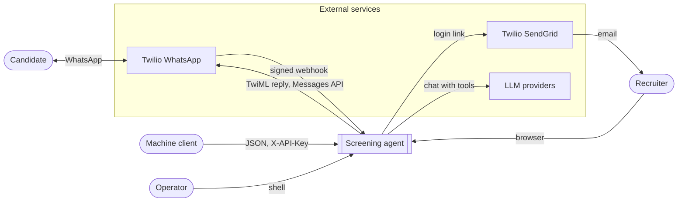
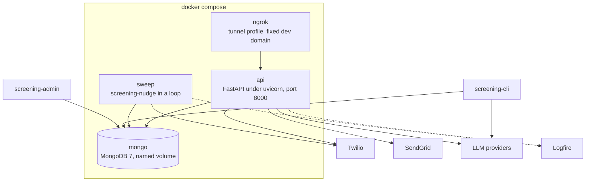
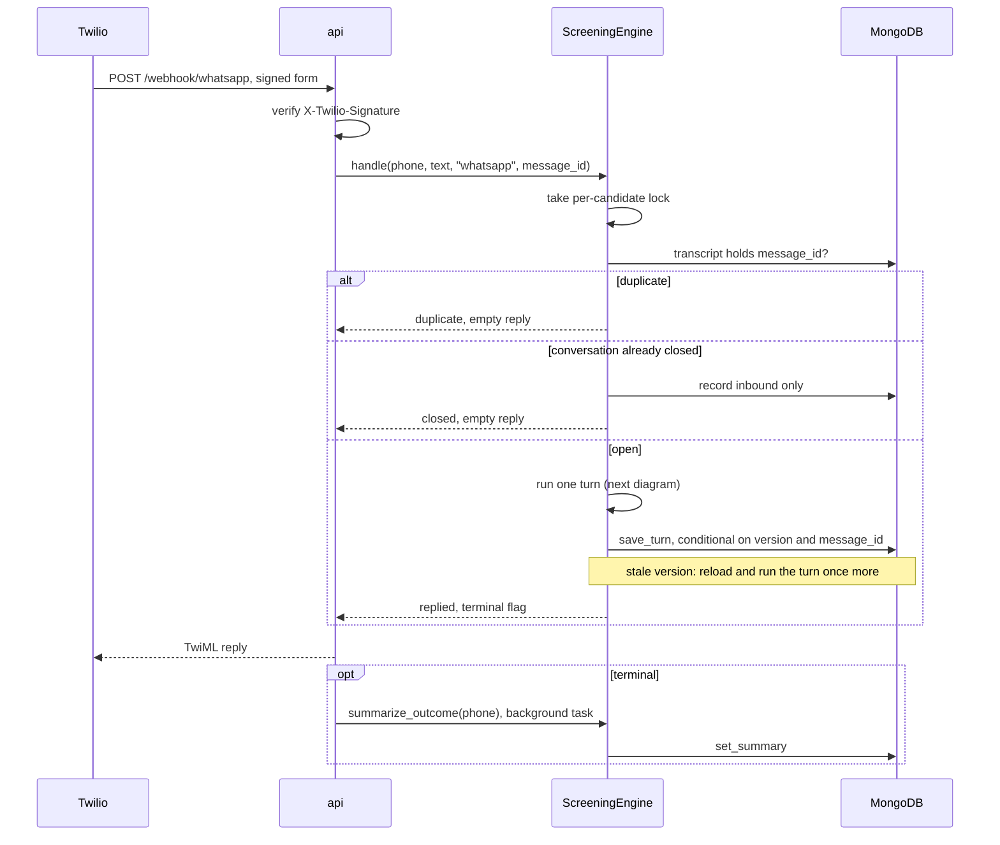
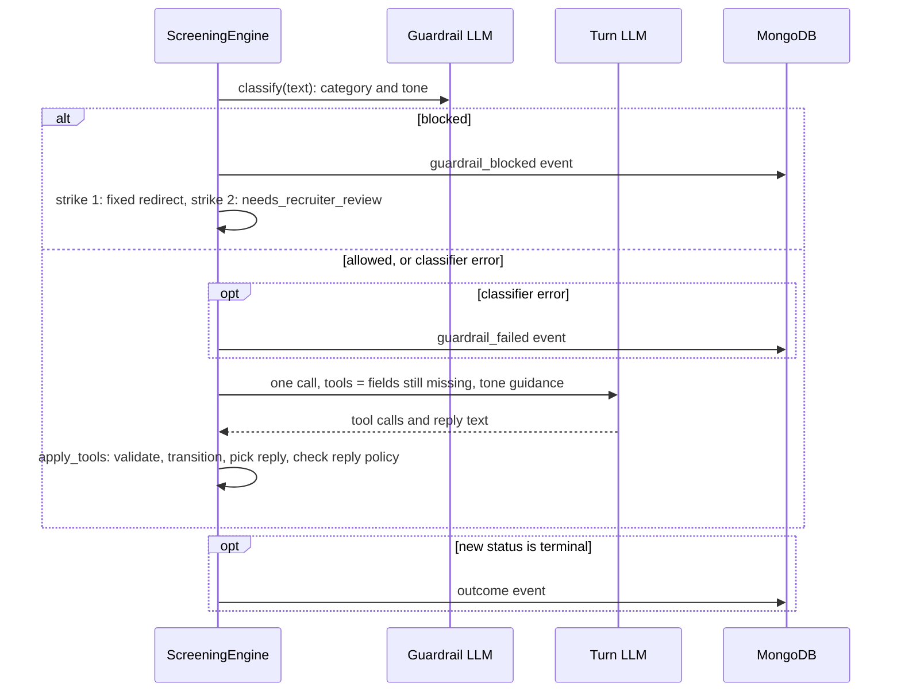
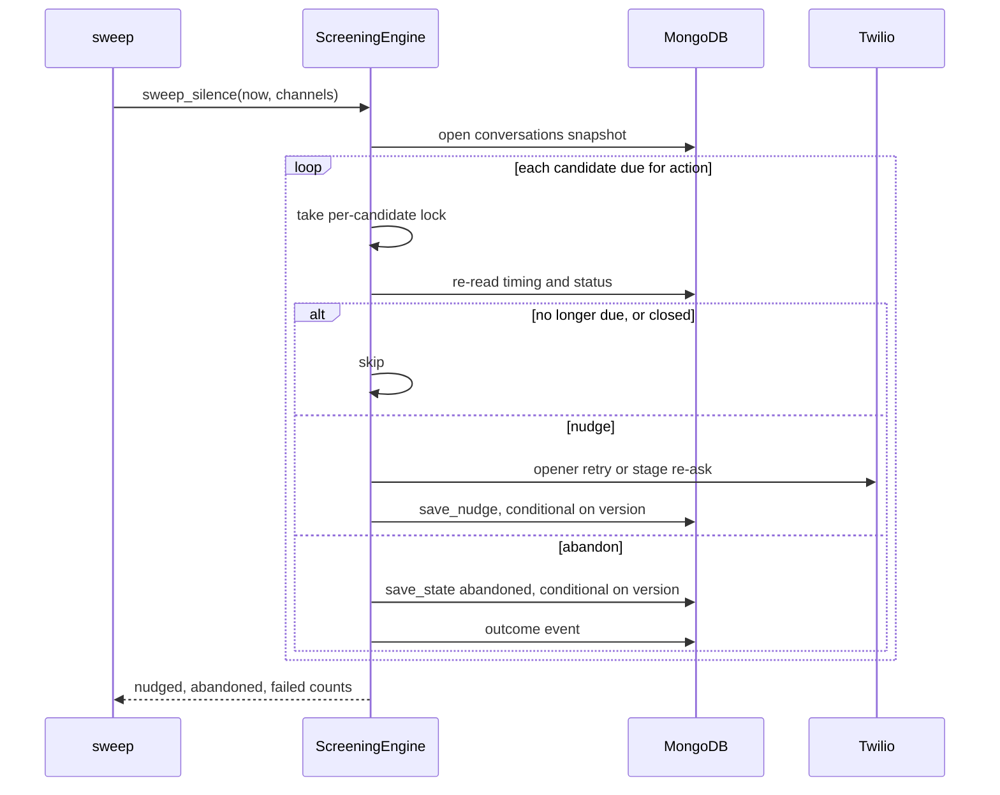

# Grupo Sazón screening agent

AI candidate-screening agent for delivery-driver hiring, plus a recruiter API and recruiter pages. Take-home for Orbio.

Documents:

- `docs/Orbio-Assignment.md`: the brief.
- `docs/process-design.md`: the Phase 1 process design (stages, validation, outcomes, tone).
- This README: the system as built, design decisions, LLM choice, deployment and improvements.
- `docs/STATUS.md`: remaining work, requirements coverage, known gaps, open questions and deferred designs.
- `TROUBLESHOOTING.md`: demo runbook, commands run, common failures and tech debt.

## Setup

```bash
python3.12 -m venv .venv
source .venv/bin/activate
pip install -e ".[dev]"            # add ,evals for the OpenAI and Mistral bake-off candidates
export PROJECT_ANTHROPIC_API_KEY=... # Anthropic models; not ANTHROPIC_API_KEY, which Claude Code reads
export SCREENING_DEV_MODE=true      # local only: lets the API run without the secrets below
export SCREENING_SESSION_SECRET=...        # signs the recruiter session cookie, see below
export SCREENING_RECRUITER_EMAIL_DOMAINS='["gruposazon.com"]'   # who may log in
export SCREENING_SENDGRID_API_KEY=SG...    # login links go out through Twilio SendGrid
export SCREENING_LOGIN_EMAIL_FROM=...      # a sender verified in SendGrid
# export SCREENING_LOGIN_EMAIL_REDIRECT_TO=...   # dev mode only: every login email goes to this demo inbox
export SCREENING_PUBLIC_URL=https://...    # base URL of every login link; required outside dev mode
export SCREENING_TWILIO_AUTH_TOKEN=...     # verifies X-Twilio-Signature on the webhook
export SCREENING_TWILIO_WEBHOOK_URL=...    # the exact URL set in the Twilio console, see below
export SCREENING_TWILIO_ACCOUNT_SID=...    # outbound: opener and nudges, used in the Messages URL
export SCREENING_TWILIO_API_KEY_SID=SK...  # outbound REST auth (API key, not the auth token)
# export SCREENING_DEMO_PHONES='["+34600111222"]'   # demo only: candidate ids a recruiter may reset from the console
export SCREENING_TWILIO_API_KEY_SECRET=...
export SCREENING_TWILIO_WHATSAPP_FROM=+14155238886
export SCREENING_TWILIO_OPENER_CONTENT_SID=HX...   # approved opener template; plain text fallback in sandbox
export SCREENING_LOGFIRE_TOKEN=...          # tracing; unset means no tracing and nothing sent
export SCREENING_CANDIDATE_HASH_SECRET=... # keys the candidate id in traces; unset, traces carry none
export SCREENING_DATABASE_URL=mongodb://localhost:27017/screening
```

Docker: copy `.env.example` to `.env`, fill the secrets, then `docker compose up --build`. The stack runs the API on port 8000, a sweep loop and MongoDB with a named volume. Add `--profile tunnel` to also run the `ngrok` service, which publishes the API at the account's fixed ngrok dev domain (`NGROK_AUTHTOKEN`, `NGROK_URL`); set `SCREENING_PUBLIC_URL` and `SCREENING_TWILIO_WEBHOOK_URL` to that domain. Without the profile no tunnel starts. Tests also need Docker: pytest starts a throwaway `mongo:7` container and skips the repository-backed tests when no Docker socket is present.

Configuration is read from `SCREENING_*` environment variables or `.env`. See `screening_agent/config.py` for every setting and its default.

### Recruiter login

Recruiters do not get a password or a key. An admin invites each work address with `screening-admin invite <email>`. The address must be at a domain in `SCREENING_RECRUITER_EMAIL_DOMAINS`; the domain list is a second gate, not the grant. The recruiter types that email at `/recruiter/login`, opens the link that arrives and presses a button. The GET only shows the button, so a mail scanner that prefetches the link does not burn it; the POST consumes it. The link works once and expires after `SCREENING_LOGIN_LINK_MINUTES` (default 15). It always points at `SCREENING_PUBLIC_URL`, never at the request's `Host` header, which a caller can forge. Only dev mode falls back to the request URL. An uninvited address, an unknown domain, a deactivated recruiter, a throttled request and a mail-provider failure all answer the same "check your inbox" page and send nothing. Each address gets one email per `SCREENING_LOGIN_EMAIL_COOLDOWN_SECONDS` (60) and each client IP at most `SCREENING_LOGIN_REQUESTS_PER_IP` (30) per `SCREENING_LOGIN_IP_WINDOW_MINUTES` (60). Behind a proxy, set `FORWARDED_ALLOW_IPS` to the proxy's address so uvicorn trusts its forwarded headers and the limit sees the caller. The session cookie lasts `SCREENING_SESSION_HOURS` (default 12), is signed with `SCREENING_SESSION_SECRET`, and is marked `Secure` when `SCREENING_PUBLIC_URL` is https. `screening-admin deactivate <email>` blocks new links, ends every session issued before it, and works before the address has ever been invited. `reactivate` lifts the block without reviving those sessions. Removing a domain from the allowlist also ends its recruiters' sessions. The override form carries a CSRF token bound to the session cookie. The session secret is the one secret this app owns. Generate it once:

```bash
python -c "import secrets; print(secrets.token_urlsafe(32))"
```

The login pages and the login email are localised by `recruiter/i18n.py`: `es-MX` by default, `es-ES` and `en-US` through the `?lang=` links on the login form, remembered in the `recruiter_lang` cookie, otherwise taken from `Accept-Language`. Pages behind the login stay English.

In dev mode without the SendGrid settings, the login email is written to the process's stderr, which Docker shows in `docker compose logs api`; it is never a log record, so tracing cannot export it. `SCREENING_LOGIN_EMAIL_REDIRECT_TO` delivers every login email to one address instead of the recruiter's, for a demo inbox; it is honoured in dev mode only and the login form answers 503 when it is set outside dev mode.

Upgrading from a deployment where any address at an allowed domain could log in: existing recruiter rows survive unchanged and keep working. A recruiter who has never logged in needs `screening-admin invite <email>` before their first link is sent.

Three mechanisms behind the login are worth knowing when changing it:

- The CSRF token on the override form is an HMAC of the session cookie, not a stored value. The server keeps no extra state, and a stolen token is useless without the exact cookie it was minted from.
- Session revocation is a timestamp on the recruiter row (`sessions_valid_after`), not a token blocklist. One write invalidates every outstanding cookie. The JWT `iat` is a float timestamp. MongoDB stores `sessions_valid_after` to the millisecond, so a session issued inside the deactivation's millisecond also counts as revoked.
- The login link separates GET (show a button) from POST (consume the token). Mail scanners follow GET links but never submit forms, so a prefetch cannot burn the link or log the scanner in.

### Machine clients and admin

Machine clients send a per-client key in the `X-API-Key` header. Mint, list and revoke keys and manage recruiters with the admin CLI:

```bash
screening-admin create-api-key ats-sync   # prints the key once
screening-admin api-keys
screening-admin revoke-api-key <key id>
screening-admin recruiters
screening-admin deactivate ana@gruposazon.com
```

Every override event records who did it (`recruiter:<email>` or `api_key:<label>`).

### Twilio webhook

`SCREENING_TWILIO_WEBHOOK_URL` is the public URL you type into the Twilio console as the WhatsApp sender's "when a message comes in" webhook, for example `https://<your-tunnel-host>/webhook/whatsapp`. Twilio signs that exact string. Set it when the app sees a different URL than Twilio called, which is the case behind a tunnel or reverse proxy, including the Docker stack behind the `ngrok` compose service (`docker compose --profile tunnel up`, with `NGROK_AUTHTOKEN` and `NGROK_URL` set). Leave it empty when Twilio reaches the app directly at the URL it signed.

## Run

```bash
screening-cli                        # text chat against the screening flow
uvicorn screening_agent.api.app:app  # webhook, candidates, analytics, recruiter pages at /recruiter/
screening-nudge                      # silence sweep for cron: nudges, then abandons
pytest                               # unit and flow tests, no LLM calls
python -m evals.run_evals            # persona evals against the configured models, PASS/FAIL per persona on stderr
python -m evals.run_evals --models anthropic:claude-sonnet-5-5,openai:gpt-6.1-sol,mistralai:mistral-medium-3-5 \
    --guardrail-models anthropic:claude-haiku-5-5,openai:gpt-6-luna,mistralai:mistral-small-2603 \
    --judge --out docs            # bake-off: writes docs/bakeoff.json and bakeoff.html
python -m evals.render_report docs/bakeoff.json   # rebuild bakeoff.html from saved results, no LLM calls
ruff check . && ruff format .
pyright                              # standard mode, config in pyproject.toml
```

## HTTP surface

| Route | Auth | Purpose |
| --- | --- | --- |
| `POST /webhook/whatsapp` | Twilio signature | Inbound candidate message. Answers TwiML with the reply. |
| `POST /candidates` | recruiter | Opens a conversation and sends the opener. Candidate id is the E.164 phone. |
| `GET /candidates` | recruiter | Candidate list, newest first. `status` and `stage` filters answer 422 for an unknown value. `limit` (default 100, at most 500) and `offset` page it. |
| `GET /candidates/{id}` | recruiter | Profile, summary, transcript and events. |
| `PATCH /candidates/{id}` | recruiter | Outcome override. Writes a `recruiter_override` event with the actor. |
| `GET /analytics` | recruiter | Funnel counts. |
| `GET /csrf-token` | recruiter | The CSRF token for the caller's session cookie, or `null` for an API key. |
| `/recruiter/...` | session cookie | Server-rendered pages: login, candidate table with filters and funnel, detail with the transcript, a per-turn inspector and the override form. The detail page reloads itself every `SCREENING_CANDIDATE_PAGE_REFRESH_SECONDS` while the conversation is open. |

"recruiter" means a session cookie or an `X-API-Key`. A cookie caller on `POST` or `PATCH` must also send the token from `GET /csrf-token` in `X-CSRF-Token`, because `SameSite=Lax` still sends the cookie from sibling subdomains. Routes answer 503 until their secrets are configured, unless `SCREENING_DEV_MODE` is on. Page routes answer 303 to login instead of 401.

## How it works, in plain language

This section is for reviewers and readers who do not write code. It describes what the system does and who decides what. The Architecture section after it gives the same system in technical diagrams.

### What the system does

A candidate applies for a delivery-driver job. A recruiter, or the company's hiring software, registers the candidate's phone number with the system. The candidate then gets a WhatsApp message from an assistant called Sazón. This first message is called the opener. The link from the application form to this system is not built, so today the registration is a manual or external step. The assistant says it is an AI, asks for permission to continue, then asks seven short questions one at a time. The conversation ends in one of four results. A recruiter sees the result, a short summary, the full chat and every decision the system made.

The goal is simple. Recruiters today spend most of their phone time on people who cannot be hired. The assistant does the first pass and hands recruiters only the candidates who passed the two objective checks: a valid driving licence and a home city where Grupo Sazón has a restaurant.

### Two parts: the AI that talks and the code that decides

The system has two parts with different jobs.

- **The AI model talks.** It reads the candidate's message, understands it in Spanish or English, and writes a friendly one-line reply. It also fills in the boxes of a form that the message answers, usually one, for example "has licence: yes". A second, smaller AI check runs before it and only decides whether the message is about the application.
- **The code decides.** The code owns the form, the order of the questions, the rules for a valid answer, the four results and every message that matters legally.

A useful picture is an interviewer with a clipboard. The AI is the interviewer. The code is the clipboard. The clipboard shows only the question that comes next. The interviewer cannot write in a box that is not on the page. So the AI cannot ask about experience before the licence question, because that box does not exist yet. The code adds it only after the licence answer is recorded.

This is the single most important design choice. The rules about consent, question order and rejection do not depend on the AI following instructions. They depend on which boxes the code shows it.

### The questions, in order

The questions run cheapest disqualifier first. The two hard stops come before any detail a recruiter would read.

| Step | Question | What can happen |
| --- | --- | --- |
| 1 | May we continue? (consent) | No: the chat stops and a recruiter follows up. |
| 2 | Full name | Unclear: asked again once, with an example. |
| 3 | Valid driving licence? | No: not qualified. The candidate hears the real reason. |
| 4 | Which city? | No restaurant there: not qualified. Close match: the assistant asks "Do you mean X?" first. |
| 5 | Availability (full-time, part-time, weekends) | Unclear: asked again once. |
| 6 | Preferred shift | Unclear: asked again once. |
| 7 | Delivery experience | Zero is a valid answer. |
| 8 | Start date | A past date: asked again once. |

A candidate who answers several questions in one message skips ahead. The code accepts every answer it can match and moves to the first question still open.

### The four results

| Result | Who decides | What the candidate hears |
| --- | --- | --- |
| Qualified | Code, when every answer is valid | A recruiter will book a short interview. |
| Not qualified | Code, only for no licence or no restaurant nearby | The real reason, and that the application stays on file. |
| Needs a recruiter | Code, when the candidate says no to consent or anything is unclear | A recruiter will follow up. |
| Abandoned | Code, after a long silence | Nothing further. |

Only two facts cause an automatic no. Everything that needs judgement goes to a person. A recruiter can change any result from the recruiter web page, and the change is logged with their name.

### What happens to one message

1. The candidate sends a WhatsApp message. Twilio, the messaging provider, forwards it to the system.
2. The system checks the message really came from Twilio. A forged message is rejected. This check is active in the production configuration; the local development mode can run without it.
3. The system checks it has not already handled this exact message. Twilio delivers a message again when it gets no answer. A repeat is ignored.
4. A small, fast AI check asks: is this message about the application? Off-topic or abusive messages get one polite redirect. A second one closes the chat for a recruiter to review. The same check also reads the candidate's tone: neutral, confused or frustrated. If this check itself fails for a technical reason, the message goes through instead of being blocked and the tone counts as neutral.
5. The main AI model reads the message with the open questions in front of it. It fills in the matching box and writes a reply. A confused or frustrated candidate gets a calmer, simpler instruction for this turn.
6. The code checks the answer against the rules. A valid answer is recorded and the next question is prepared. An invalid answer is asked again with a fixed example message. Two invalid answers to the same question send the candidate to a recruiter instead of looping.
7. The code picks the reply. Important messages come from fixed text, not from the AI: the re-asks, the city confirmation, the qualified message and every closing message. The AI's own words are used only for ordinary turns, and only when they pass the reply rules: one question, at most one emoji, short, no formatting or links, in the candidate's language. A reply that breaks a rule is replaced by the fixed question for the current step.
8. The message, the updated form, the reply and a record of why the system replied as it did are saved together as one unit. Either all of it is saved or none of it. If the system crashes halfway, nothing is recorded, and the copy Twilio sends again is handled as new. The save happens before the reply is delivered. If delivery then fails, the form has moved on and the candidate hears nothing until the two-hour nudge repeats the open question.
9. The reply goes back through Twilio to the candidate.
10. When the result is final, the system writes a short summary for the recruiter. This happens after the reply is sent, so the candidate never waits for it.

The whole exchange costs one main AI call per candidate message, plus the small check in step 4.

### When a candidate goes quiet

No timer runs inside the system. A separate task, called the sweep, wakes every few minutes and looks at the saved times of the last messages.

- No answer to the first message: the opener is sent again after about one day. After two days the candidate is marked abandoned.
- Silence after the chat has started: a nudge after about two hours and a last nudge after about twenty-three hours. After a day the candidate is marked abandoned, and the recruiter sees which question they stopped at.

The nudge repeats the open question. If the candidate replies while the sweep is sending a nudge, the candidate may still receive that nudge, but the saved record keeps the candidate's reply and drops the nudge.

### Where the information lives and who can see it

Each candidate is one record in the database: their answers, the result, the full chat and the timing. Every result, override, blocked message and failed nudge or summary is also written to a separate log that is only ever added to, never edited. Each answered message also carries a decision record: the step before and after, what the checks decided, which answers were accepted or rejected and why, where the reply came from, and the AI text a fixed message replaced. When tracing is on, timing and cost data goes to Logfire, a monitoring service. No message text, phone number or email goes there. A failure of the main AI call is not logged there; it shows up as an error and the message is handled again when Twilio resends it.

Recruiters open a web page. There is no password. They type their work email and click the link that arrives. The link works once and expires in minutes. Other software, for example the company's hiring system, uses its own access key instead. Every change to a result records who made it.

### What a reviewer can rely on

- The AI cannot skip the licence or city check. The conversation stays on the first unanswered question until it is answered, and a no on either check closes the conversation at once, whatever else the candidate said.
- A candidate is never rejected automatically for a judgement call. Only the two objective checks disqualify.
- A rejected candidate always hears the true reason from fixed text, in Spanish or English. The system detects which of the two the candidate writes in and defaults to Spanish for anything else.
- Every result and every override has a logged reason and a named actor.
- A repeated or retried message is never processed twice.
- The AI model can be swapped by a setting. The rules stay in the code and do not move with the model.

### What is not built yet

The voice-call channel, the silence scheduler inside the API, the recruiter console, the public intake page and the queue-backed worker are not built. Each has its rationale and tradeoffs in `docs/process-design.md` ("Designed, not built"). SMS is dropped. The unknown-number reply, candidate ids that are not phone numbers and the applicant name with its mismatch review are planned in `PLAN.md` and not built. The list of restaurant cities is sample data, not the client's real list of 45 locations. The test that compares AI models has not produced a valid run yet (see LLM choice). Remaining work is tracked in `docs/STATUS.md`.

## Architecture

The section follows the [C4 model](https://c4model.com): system context, then containers, then two runtime views. Stage order, validation rules and outcomes are design, owned by `docs/process-design.md`.

### System context

Who talks to the system and what it depends on.



| Actor or system | Role |
| --- | --- |
| Candidate | Delivery-driver applicant. Only ever talks to Twilio. |
| Recruiter | Grupo Sazón staff. Browser plus an emailed one-time login link. |
| Machine client | For example an ATS sync. Same JSON routes, per-client key. |
| Operator | Mints keys and manages recruiters with `screening-admin`, runs the sweep from cron or the `sweep` container. |
| Twilio WhatsApp | Delivers each message as a signed form POST, relays the TwiML reply, carries outbound openers and nudges over the Messages REST API. |
| Twilio SendGrid | Sends the login email. |
| LLM providers | Anthropic, OpenAI and Mistral through the provider table. Bedrock and Vertex only through LangChain's `init_chat_model`. |

### Containers

Runnable units as deployed by `compose.yaml`, plus the two local processes. `ngrok` runs only under the `tunnel` profile. Edges to external services show what each process actually calls.



| Process | Serves | Calls out to |
| --- | --- | --- |
| `api` | Webhook, JSON routes, recruiter pages | Twilio (TwiML, Messages API), SendGrid (login email), LLM providers (turn, guardrail, summary), Logfire when `SCREENING_LOGFIRE_TOKEN` is set |
| `sweep` | Silence policy every `SWEEP_INTERVAL_SECONDS` | Twilio, and Logfire when the token is set. Nudge text is a fixed template and `abandoned` gets no summary call. |
| `mongo` | Collections `candidates`, `events`, `recruiters`, `api_keys`, `login_tokens`, `login_throttles` | nothing |
| `ngrok` | Public HTTPS at `NGROK_URL`, forwarded to `api:8000`; local inspector on `127.0.0.1:4040` | ngrok's edge |
| `screening-cli` | Local text chat | LLM providers only. No Twilio. |
| `screening-admin` | Keys and recruiter accounts | nothing |

`api` and `sweep` run the same image and the same `ScreeningEngine`. They share no memory. Each process serialises one candidate with a local lock, and the candidate document's `version` field arbitrates between processes: a write from a stale version fails, the webhook re-runs its turn once, the sweep skips that candidate. No queue, no replica set, no transactions across documents.

### Runtime view: one inbound WhatsApp message

Two diagrams. The first is the request path and the three outcomes `handle` can return. The second is the inside of one turn.





What the diagrams fix in place:

- One LLM turn per message. The guardrail is a second, cheaper call that runs first and fails open.
- The graph is two nodes, `turn` and `apply_tools`, invoked once per message with no checkpointer. State lives in the candidate document, not in LangGraph.
- Inbound message, turn record, new state and reply are written together. A turn that is not saved leaves no record. A crash before the write leaves no transcript entry, so Twilio's retry is processed as new. Guardrail events written earlier stay in `events`.
- The summary never delays the reply. It runs after the response is sent and outside the lock.
- Each step is a span (`handle`, `guardrail`, `turn`, `summary`, `sweep`, `nudge`) with metadata only. Candidate ids are removed from URLs, and exception messages never name the candidate, because Logfire does not scrub exception text or URL attributes.

### Runtime view: silence sweep



`silence_action` in `flow/silence.py` is a pure decision over stored timestamps and holds the thresholds. A failed send is isolated to that candidate as a `nudge_failed` event. A stale version on save means the candidate replied while the sweep ran. Their turn wins and the sweep logs `nudge_unrecorded` instead.

### Components

| Package | Responsibility | Depends on |
| --- | --- | --- |
| `domain/` | `CandidateProfile` with every validation rule, enums, service-area matching, language detection, candidate-local clock. No I/O. | nothing |
| `flow/` | `ScreeningEngine` (entry point for all channels), the two-node LangGraph, tool gating, transitions, fixed replies, silence policy. | `domain`, `llm`, `storage` |
| `llm/` | `chat_model` constructor and provider table, turn prompt, guardrail classifier, summary. The only place a provider is constructed (`init_chat_model` in `llm/models.py`). | `domain`, `flow.state` |
| `storage/` | `Repository` over pymongo: candidate document, events, recruiters, API keys, login tokens and throttles. All atomic writes live here. | `domain`, `flow.state`, `flow.silence`, `flow.turn_record` |
| `channels/` | Adapters: Twilio WhatsApp inbound parsing and outbound REST, SendGrid email, the three CLIs. | `flow`, `storage`, `api.auth` |
| `api/` | FastAPI app, auth (`Principal` from session JWT or API key), fail-closed dependencies, webhook signature check. | `flow`, `storage`, `channels` |
| `observability.py` | Logfire configuration, URL and contact redaction, keyed candidate hash. Engine spans use the OpenTelemetry API, so nothing is traced until the API or `screening-nudge` configures Logfire. | `config` |
| `recruiter/` | Jinja2 pages mounted at `/recruiter`, no JavaScript. Login form, table, detail, override form. | `api`, `storage`, `channels.email` |
| `evals/` | Scripted personas, code graders, LLM judge, guardrail set, bake-off report. Not shipped in the image. | `flow`, `llm` |

`domain` imports only `config`. `flow.state` is the shared state type, imported by `llm` and `storage` as well as `flow`, so the engine, the prompt and the repository agree on one shape. Nothing in `domain`, `flow`, `llm` or `storage` knows which channel it serves.

## Key design decisions

- **One LLM call per candidate message.** The model calls a recording tool and writes its reply in the same turn. Code validates the tool arguments, advances the stage, and swaps the tool set.
- **Structural guardrails.** The model cannot ask about experience before the licence check because that tool is not exposed yet.
- **Code-owned closing messages.** Re-asks, confirmations, disqualifications and the qualified message are fixed text per language, so compliance wording never depends on the model.
- **Two automated stops only.** No licence and out of service area. Everything ambiguous goes to `needs_recruiter_review`.
- **Idempotent inbound.** A redelivered webhook returns `duplicate` and a failed turn is retried as new, so Twilio retries are safe. Mechanism in Architecture, runtime view.
- **Tool gating is enforced twice.** The model only sees the tools for fields still missing from the current stage onward, and a call to any other tool is rejected when applied. Allowed tools are recomputed after each accepted call, so one message can answer several questions. Model misuse of a tool re-asks the current question and is never counted against the candidate.
- **Candidate-local dates.** "Today" for start dates and the prompt is the calendar day in the candidate's service-area timezone, not the server's.
- **One document per candidate.** Chosen so a turn is one atomic write with no replica set or transaction. Mechanism in Architecture, containers.
- **Fail-closed API.** Recruiter routes and the webhook return 503 until their secrets are configured, unless `SCREENING_DEV_MODE` is on. Dev mode opens the recruiter routes only while `SCREENING_SESSION_SECRET` is unset, and skips the webhook signature only while `SCREENING_TWILIO_AUTH_TOKEN` is unset. A stray dev-mode flag on a deployment with real secrets opens neither. The login-mail redirect follows the same rule: honoured in dev mode only, 503 from the login form otherwise. The summary LLM call runs as a background task after the reply.
- **People log in by email, machines by key.** The recruiter pages are plain HTML forms on the API app. Login is a one-time emailed link. The cookie is a signed, expiring session, not a secret, and deactivating a recruiter ends it on the next request. JSON routes accept that cookie, with a CSRF header on writes, or a per-client `X-API-Key` whose hash lives in MongoDB. Nothing is pasted or shared.
- **Every turn explains itself.** The inbound transcript entry carries a turn record: stage before and after, guardrail category, tools exposed and called, why each call was accepted or rejected, where the reply came from, the model text a template replaced, tokens, latency and the trace id. It is written in the same update as the turn, so a turn that is not saved leaves no record. The recruiter candidate page shows it under every answered message. Traces in Logfire carry metadata only: no message text, phone numbers or emails.
- **Model replies are checked before sending.** One question, one emoji, a length limit, no markdown or links, the candidate's language. A reply that breaks a rule is replaced by the fixed question for the current stage, with no second AI call. The guardrail call also reads the candidate's tone, and a confused or frustrated candidate gets a calmer instruction for that turn.
- **Guardrail fails open.** One structured-output classification before each turn. A classifier outage allows the message and logs an event. It never blocks a candidate.
- **Silence is a cron sweep.** No long-lived timers, so a restart loses nothing and the policy is a pure function over stored timestamps. Mechanism in Architecture, runtime view.
- **Provider is configuration.** `SCREENING_LIVE_MODEL`, `SCREENING_SUMMARY_MODEL` and `SCREENING_GUARDRAIL_MODEL` take any `provider:model` id supported by LangChain. `llm/models.py` is the single constructor. Provider keys come from settings, so `.env` works outside Docker too: `PROJECT_ANTHROPIC_API_KEY`, `OPENAI_API_KEY`, `MISTRAL_API_KEY`. A missing key fails closed, so a shell `ANTHROPIC_API_KEY` is never billed by accident. Anthropic and OpenAI ids get no sampling parameters, Mistral runs at temperature 0, Bedrock and Vertex use their cloud credentials.
- **Evals grade outputs, the judge grades words.** Personas are scripted turns because the stage order is fixed. Code graders check the final JSON, outcome and turn count. Reply style uses the same rules as the live reply policy (`flow/reply_policy.py`), applied to the raw model text, not to the fixed question that replaced it. The report shows the policy fallback rate per model. A fixed Haiku judge scores tone and summary usefulness so the bake-off compares models on the same yardstick.
- **The bake-off fails loudly.** The run exits 1 when any persona fails or any scored guardrail classifier is below `--guardrail-min-accuracy` (default 0.9) or above `--guardrail-max-latency-seconds` at p95 (default 2.5), or below `--tone-min-accuracy` on the candidate-tone cases (default 0.8). An unavailable classifier scores zero and fails. Every turn, summary, guardrail and judge model id is constructed before the first paid call, so a missing key or unknown provider is a usage error, not a lost run. Eval databases live on `SCREENING_EVAL_DATABASE_URL` (default local Mongo), never on the app's `SCREENING_DATABASE_URL`. `--out` writes `bakeoff.json` (the results contract, with a `schema_version`) and `bakeoff.html`. The HTML report is self-contained, no JavaScript: per-model bar charts, a persona pass matrix, guardrail gates with threshold markers, and side-by-side transcripts with style flags, judge scores and summaries. Rebuild the report from the JSON with `python -m evals.render_report`. Cost per screening averages only personas that finished without an error, and a model with no replies shows n/a. p95 is the inclusive percentile over answered classifier calls, so failed calls never flatter the latency gate.
- **Demo reset archives, never deletes.** A recruiter can reset a candidate whose id is in `SCREENING_DEMO_PHONES`, an allowlist separate from dev mode so no real candidate can be reset. The document and its events move under a new id (`<phone>~<suffix>`) with `archived_at` and `archived_by`, a `demo_reset` event records the actor, and the phone is free for a new screening. Standalone Mongo has no transactions, so the move is a fenced, idempotent sequence: a pipeline update sets the archive id once and bumps `version`, the copy is an upsert, the events are re-keyed, and the delete is keyed on that version. A turn that lands between the fence and the delete makes the delete miss, and the sequence repeats from the fence, at most three times. Archived copies are hidden from the list, the funnel and the silence sweep, and stay readable at their own page.

## LLM choice

Defaults in `screening_agent/config.py`: `anthropic:claude-sonnet-5-5` for the candidate turn, `anthropic:claude-haiku-5-5` for the guardrail classifier and the summary. Any `provider:model` id can replace them by setting.

Why this pair, from design rather than measurement:

- The turn is tool use under constraint. One call must pick the right recording tool, give valid arguments and write a short reply in the candidate's language. Current Claude models follow a bound tool set and a strict reply format reliably, which matters more here than raw reasoning.
- Spanish from Spain and Mexico with slang, typos and code-switching. The judge personas in `evals/` exercise this, and the live reply policy catches a language mismatch, but the base model still has to read "no tengo carnet" and "ps si" correctly.
- Latency is in the chat loop. Haiku runs before every turn as the guardrail and after the last one as the summary. A fast small model keeps the per-message cost at two calls without a visible pause.
- One provider for all three roles keeps the key handling, the usage metadata and the error shapes the same.

What the scripted bake-off showed. The run saved in `docs/bakeoff.json` on 27 Oct compared Sonnet, `openai:gpt-6.1-sol` and `mistralai:mistral-medium-3-5` on the persona set. Every Anthropic call answered 400 because the org-level key was sent without the workspace header, and every OpenAI call answered 400 as well. Only Mistral completed. That run does not support a model choice, and the report says so (`docs/bakeoff.html`). The workspace header is now sent from `PROJECT_ANTHROPIC_WORKSPACE_ID`. Re-running the bake-off is the first item under Potential improvements, and the defaults change to the winner when it runs.

What would change the choice: a policy fallback rate above a few percent on Sonnet (the model keeps writing two questions or an emoji), a guardrail accuracy below 0.9 or p95 latency above 2.5 s on Haiku, or a cost per screening that the per-screening budget cannot carry at 1000 applications a week.

## Deployment and scaling

Today: `compose.yaml` runs `api`, `sweep` and `mongo` on one host, plus `ngrok` under the `tunnel` profile for a public URL. Secrets come from `.env`. Behind the tunnel the login throttle sees the `ngrok` container's address unless `FORWARDED_ALLOW_IPS` names it. The API fails closed on every route whose secret is missing. Tracing is on when `SCREENING_LOGFIRE_TOKEN` is set and carries metadata only.

Monitoring. Logfire holds the spans: `handle`, `guardrail`, `turn`, `summary`, `sweep`, `nudge`, with model, token counts and latency on each. The alerts worth setting first, all from attributes already exported:

- Guardrail failure rate (`guardrail_failed` events). The guardrail fails open, so a provider outage shows here before it shows anywhere else.
- Policy fallback rate per model. A rise means the prompt or the model drifted and candidates are getting fixed questions instead of replies.
- Failed nudges (`nudge_failed` events) and sweep lag. Both mean silent candidates are not being followed up.
- Turn latency p95 over the webhook. Twilio retries a webhook that takes too long, which the dedupe absorbs but the candidate still waits.

Scaling to 10K candidates a week. 10K a week is about one candidate a minute on average and a few a second at peak, with roughly 10 messages each. The limits, in the order they are hit:

1. The per-candidate lock is process-local. Two API processes can run the same candidate's turn at once; the version check on the document turns the loser into a retry, so it is correct but wasteful. The next step is a lease per candidate in MongoDB, the same single-write pattern the login throttle uses, so any number of API replicas serialise one candidate.
2. The silence sweep is one process over every open conversation. At 10K a week with a 24 h abandon window that is tens of thousands of documents per tick, fine for Mongo with the existing indexes, but one sweep must not run beside another. The deferred design in `docs/STATUS.md` moves the sweep into the API process behind a lease, with a claim per nudge so a nudge is sent at most once across replicas and restarts.
3. LLM rate limits. Two calls per message at peak is a few calls a second, inside provider limits, but a provider incident stalls every conversation at once. The model id is a setting, so the first mitigation is a second provider configured and tested in the bake-off, switched by redeploy.
4. MongoDB. One document per candidate with the transcript embedded stays under the 16 MB limit by a wide margin for a 10-message screening. Reads on the recruiter list are paged and indexed on `status` and `updated_at`. The next index is on events `(kind, created_at)` when the analytics series land.

Deployment shape at that scale: the API as a stateless replica set behind a load balancer, MongoDB as a managed replica set, the sweep inside the API behind the lease, Logfire for traces and alerts, secrets from the platform's secret store instead of `.env`. The webhook signature check and the dedupe already make the API safe to run more than once.

## Potential improvements

In order of value for the client:

1. **Run the bake-off to completion** with the workspace header fixed, then set the model defaults from the result instead of from design. The harness, the gates and the report exist.
2. **Silence scheduler inside the API** with a sweep lease and per-nudge claims, so the compose `sweep` service and its one-process limit go away. Designed under "Deferred past the deadline" in `docs/STATUS.md`, not built.
3. **Realistic personas and the real 45 locations.** The eval personas are clean scripted turns. Candidates write with typos, slang and one-word answers, and the service-area list is a 16-city sample.
4. **Analytics series**: completion rate, drop-off stage and average duration, from timestamps the documents already carry. The funnel today counts by status and stage only.
5. **Interview scheduling** as the step after `qualified`, as one more tool at the outcome stage.
6. **ATS integration**: the JSON API already exposes `GET /candidates` and `GET /candidates/{id}` with the full profile, transcript and events, so the remaining design is an outbound webhook on the `outcome` event.
8. **Voice channel** on the same engine through Pipecat, with speech-to-text and text-to-speech as adapters. The engine takes text and returns text, so no screening logic changes.
9. **Roles for recruiters.** Every recruiter and API key has the same rights today.
